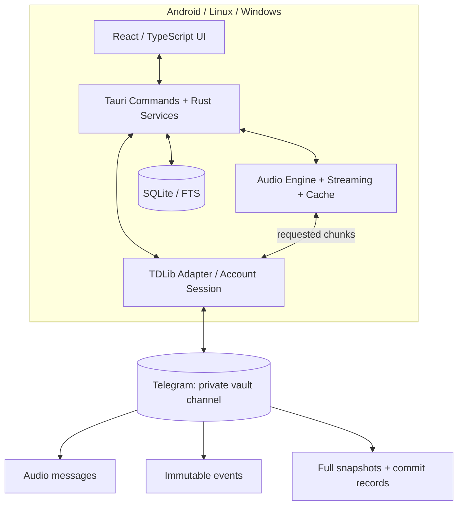
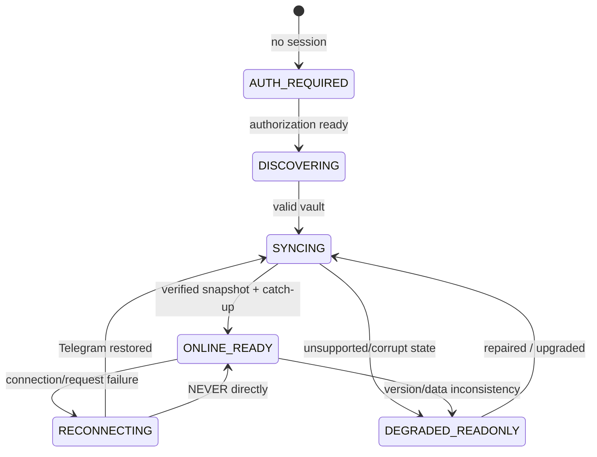
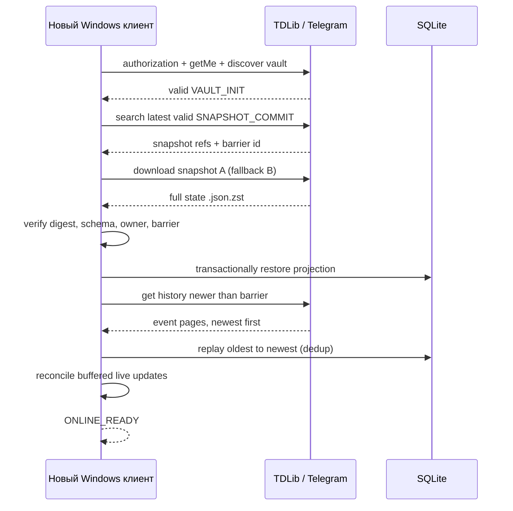

# Telegram Music Vault — архитектура, протокол синхронизации и план разработки

> **Статус:** проектное техническое задание (Design Specification / RFC 0001)  
> **Версия документа:** 1.0 • **Дата:** 19 октября 2026  
> **Рабочее название:** `<PROJECT>` (заменяется после выбора бренда)  
> **Целевые платформы:** Android, Linux, Windows; macOS — по мере готовности сборки  
> **Основная модель:** личное музыкальное облако в Telegram, без обязательного собственного сервера
>
> **Ключевая оговорка:** это спецификация предлагаемого протокола, а не заявление, что все его части уже реализованы. Конкретные возможности TDLib проверены по официальной документации в конце файла. Вызовы, относящиеся к нашему приложению (`SyncEngine`, `commitSnapshot` и т. п.), — **проектируемые интерфейсы**, а не методы TDLib.

---

## 0. Краткое резюме решений

**Что делаем:** клиент, который подключается к собственному Telegram-аккаунту пользователя, автоматически обнаруживает или создаёт приватный канал-хранилище и представляет размещённую там музыку как единую библиотеку. Один пользователь видит одинаковые плейлисты на Android, Linux и Windows. Аудио можно потоково воспроизводить, кэшировать и импортировать из своих файлов. Обмен треками с другим человеком осуществляется только по осознанному действию и при наличии прав на передачу.

**Зафиксированные решения v1:**

1. **Один приватный Telegram-канал** на одно хранилище (`<PROJECT>.<telegram_user_id>`) для медиа и служебных сообщений. Имя — подсказка для поиска, не идентификатор.
2. **TDLib** для авторизации, истории, сообщений, файлов и обновлений; **не Bot API**. Каждый клиент входит в собственный Telegram-аккаунт пользователя.
3. **Локальная SQLite** для быстрого каталога, плейлистов и индексов. Медиакэш хранится отдельно.
4. **Online-only mutations:** запрещены изменения общей библиотеки, пока сервер Telegram недоступен либо клиент не закончил проверку/синхронизацию. В офлайне — чтение кэша и воспроизведение скачанного.
5. **Append-only event log:** каждое изменение оформляется как новое служебное сообщение Telegram; существующие события приложение не редактирует.
6. **Полные snapshots** актуальной библиотеки плюс журнал событий после контрольной точки. Старые snapshots и покрытые ими события очищаются только через безопасный GC.
7. **Delete-wins + tombstones:** удалённый плейлист нельзя неявно «воскресить» устаревшей операцией. Повторное создание — с новым UUID.
8. **Один назначенный GC-координатор**, а не конкурентная очистка с нескольких устройств. Никаких обещаний «распределённого lock» там, где Telegram не даёт compare-and-swap.
9. **Локальный `track_id`/`playlist_id` — UUID;** Telegram-ссылка на аудио — отдельная пара `chat_id + message_id`.
10. **Подтверждение отправки не равно подтверждению успешной бизнес-операции:** результат определяется повторным воспроизведением событий по серверному порядку и проверкой итогового состояния.

**Не входит в MVP:** общедоступный каталог музыки, обход авторских прав или ограничений Telegram, социальная рекомендательная сеть, настоящий WebRTC P2P, гарантированное real-time фоновое обновление Android и безусловное восстановление данных после удаления всего Telegram-канала.

---

## 1. Продуктовые требования и границы

### 1.1. Обязательные пользовательские сценарии

- Авторизация в Telegram через номер/код/2FA или QR там, где это поддерживается актуальным flow TDLib.
- Обнаружение существующего хранилища либо мастер создания приватного канала.
- Импорт аудиофайлов с Android и ПК; чтение метаданных до отправки, когда файл доступен локально.
- Список треков, альбомов, исполнителей, плейлистов и избранного; поиск по локальному индексу.
- Потоковое воспроизведение при сети; кэширование и автономное воспроизведение ранее загруженного.
- Добавление/удаление треков, создание/редактирование/удаление плейлистов **только в полностью синхронизированном онлайн-состоянии**.
- Синхронизация между уже запущенными устройствами и «догоняющее» восстановление после длительного отсутствия.
- Импорт старой библиотеки по последнему валидному snapshot **без необходимости читать всю многолетнюю историю**.
- Экспорт метаданных/плейлистов как резервной копии, диагностика состояния хранилища.
- Передача конкретного трека другому пользователю через разрешённые механизмы Telegram; у получателя — явное подтверждение импорта.

### 1.2. Нефункциональные требования

| Свойство | Требование | Проверка |
|---|---|---|
| Целостность | Незавершённый upload/snapshot/GC не меняет корректный вид библиотеки | Fault-injection тесты |
| Детерминизм | Все клиенты одной версии, воспроизведя одинаковый упорядоченный журнал, получают одинаковую SQLite-проекцию | Property-based тесты |
| Идемпотентность | Дубли операций не дублируют треки/связи | Повторное применение событий |
| Скорость UI | Веб-интерфейс читает SQLite, а не пересканирует Telegram | Профилирование на 10k+ треков |
| Быстрое восстановление | Новая установка читает один полный снимок + только свежий журнал | Cold-start тесты |
| Offline | Без сети не выполняются логические мутации; скачанный трек играет | Сценарий airplane mode |
| Совместимость | Старый клиент не испортит новую схему | Version-gating тесты |
| Безопасность | Сессия TDLib и ключи не попадают в UI-логи или экспорт | Ревью логов/секретов |
| Ресурсность | Никакого HTTP-пинга `core.telegram.org` каждые 3–5 секунд | Инструментирование сети |

### 1.3. Явно принятые ограничения

- Telegram **не является транзакционной базой данных**. Нет атомарных транзакций между сообщениями и нет гарантированного CAS для закреплённого manifest.
- Невозможно одновременно гарантировать «никогда не терять ни одной правки», «разрешить офлайн-правки» и «удалять всю историю». Мы **запрещаем пользовательские офлайн-мутации**, чтобы убрать большую часть конфликтов.
- Даже при полной онлайн-синхронизации две операции могут пересечься. Конфликты решает **детерминированный reducer**, а не оптимистичное состояние UI.
- Сообщения в канале могут быть вручную удалены/отредактированы в официальном Telegram. После уничтожения всех копий валидного snapshot и нужного журнала без внешнего бэкапа восстановление не гарантируется.
- Приватные облачные каналы Telegram не являются end-to-end encrypted; объяснить это пользователю.
- Библиотека — **личное хранилище принадлежащих пользователю/разрешённых ему файлов**, а не автоматически лицензированный музыкальный сервис.

---

## 2. Общая архитектура



### 2.1. Слои и ответственность

| Слой | Ответственность | Чего не делает |
|---|---|---|
| UI | Просмотр, команды, уведомления, прогресс, разрешение конфликтов | Не отправляет Telegram-сообщения напрямую |
| Application Service | Проверяет допуск к операции; оркестрирует бизнес-действия | Не решает порядок операций по времени ПК |
| Telegram Adapter | TDLib JSON API, auth, сообщения, скачивание, upload, лимиты/повторы | Не содержит логики плейлистов |
| Vault Discovery | Поиск/валидация канала и ownership/manifest | Не доверяет одному лишь имени |
| Sync Engine | Чтение snapshot, replay, обработка updates, инварианты | Не удаляет сообщения произвольно |
| Reducer | Детерминированно применяет события к состоянию | Не зависит от сетевого времени |
| Repository | SQLite, миграции, транзакции, FTS | Не хранит Telegram-сессию в открытом виде |
| Compactor | Создаёт полное состояние на фиксированной границе | Не трогает текущие медиасообщения |
| GC | Удаляет **только доказуемо покрытую** историю | Не принимает решений «на глаз» |
| Media Engine | Кэш, stream, seek, codecs, обложки, сканирование тегов | Не пишет в общий журнал при обычном playback |
| Sharing | Разрешённая Telegram-передача и явный импорт | Не делает скрытой массовой пересылки |

### 2.2. Технологии

- **Tauri v2 + React + TypeScript + Vite**: единый UI для desktop и Android.
- **Rust**: доменная модель, reducer, транзакции SQLite, контроль состояния, планировщики.
- **TDLib (`tdjson`)**: независимая нативная сборка под Linux/Windows/Android, собственная обёртка с типизацией методов и обновлений. **Не рассчитывать, что готовый Tauri-плагин покрывает все платформы.**
- **SQLite**: `rusqlite`/`sqlx` по итогам прототипа; WAL, schema migrations, транзакции. SQLite FTS5 для поиска, если доступно в выбранной сборке.
- **zstd**: сжатие snapshot. SHA-256 — контроль целостности; **не** средство аутентификации от владельца с доступом к аккаунту.
- **Музыкальные теги**: библиотека с поддержкой MP3/FLAC/M4A/OGG; набор конкретных crates выбирается после прототипа.
- **Audio Engine**: нативный кроссплатформенный backend или отдельные адаптеры (Android Media3/ExoPlayer и desktop backend) под единым интерфейсом. Само по себе использование `<audio>` в WebView **не гарантирует** gapless, FLAC, нужный seek и фон на Android.
- **OS secret storage**: libsecret/KWallet (Linux), Credential Manager/DPAPI (Windows), Android Keystore; ключ локальной базы TDLib хранится через платформенный secure storage.

### 2.3. Предварительная структура репозитория

```text
apps/
  desktop-mobile/                 # Tauri v2 + React
    src/
      features/auth/
      features/library/
      features/player/
      features/playlists/
      features/settings/
      features/diagnostics/
    src-tauri/
      src/commands/
      src/bootstrap.rs
crates/
  vault-domain/                   # UUID, события, валидации, reducer
  vault-protocol/                 # версия wire-format, кодеки, миграции
  vault-telegram/                 # TDLib FFI/JSON, auth, file requests
  vault-sync/                     # bootstrapping, catch-up, live updates
  vault-db/                       # SQLite, migrations, FTS
  vault-snapshot/                 # compaction, checksum, GC
  vault-media/                    # file refs, chunk requests, cache
  vault-sharing/                  # private share + import
  vault-testkit/                  # имитация Telegram, fault injection
spec/
  schema/
  protocol-v1.md
  adr/
  test-vectors/
.github/workflows/
```

---

## 3. Инварианты протокола: нельзя нарушать

**I-01.** `vault_id` неизменен на протяжении жизни хранилища. Имя и Telegram `chat_id` имеют другие назначения.  
**I-02.** Идентификатор трека/плейлиста — UUID, не `file_id` TDLib и не `message_id`.  
**I-03.** На каждый `op_id` операция применяется не более одного раза.  
**I-04.** У всех устройств одинаковый **серверный порядок событий в одном канале**; локальные даты/часы не определяют порядок.  
**I-05.** Snapshot содержит **полное состояние** всех долгоживущих объектов и tombstones на точной границе (`barrier_message_id`).  
**I-06.** Любая операция после `barrier_message_id` **не входит** в snapshot и остаётся в журнале.  
**I-07.** GC никогда не удаляет активное аудио только потому, что его сообщение старше барьера.  
**I-08.** GC не запускается, пока новый snapshot, **его резервная копия** и commit не записаны и не прочитаны обратно с успешной проверкой хэшей.  
**I-09.** Старое устройство не отправляет новые пользовательские операции до законченного catch-up с актуальной версией протокола.  
**I-10.** Удаление объекта имеет приоритет перед отложенным добавлением/изменением к тому же UUID; неявное восстановление запрещено.  
**I-11.** `message send succeeded` свидетельствует о доставке сообщения серверу, но не о том, что операция изменит бизнес-состояние.  
**I-12.** Непроверенный или неизвестный **служебный** тип/версия блокирует мутации и GC; молчаливое игнорирование запрещено.  
**I-13.** Snapshot-коммит существует отдельно от указателя manifest: потеря/старость pin не уничтожает протокол.  
**I-14.** История Telegram не гарантирует непрерывных числовых `message_id`; нельзя трактовать «дырку в ID» как доказательство потерянного события.  
**I-15.** Все важные изменения SQLite (reducer + обработанный op_id + cursor) происходят **в одной транзакции**.  
**I-16.** Сканирование старых аудиосообщений не создаёт активные треки само по себе.  
**I-17.** Офлайн UI не имеет прямого способа вызвать запись в Telegram в обход backend guard.  
**I-18.** Уничтожение последнего валидного бэкапа недопустимо при штатном GC.

Эти инварианты преобразуются в автоматические property-based, end-to-end и fault-injection тесты.

---

## 4. Первоначальная настройка, поиск vault и восстановление

### 4.1. Машина авторизации

1. Запустить TDLib с указанной локальной директорией и валидным ключом БД; выдать экран входа только при отсутствии сохранённой сессии.
2. Обрабатывать `updateAuthorizationState` согласно поддерживаемому TDLib flow: номер/код, QR, пароль 2FA, ограничения попыток, блокировка и восстановление.
3. После готовности выполнить `getMe`, проверить `user_id`, выбрать профилированную базу данных именно этого пользователя.
4. Если локально имеется привязка `vault_id / chat_id`, проверить существование канала и валидный маркер.
5. Если привязки нет — найти кандидатов через `searchChats` и `searchChatsOnServer`; поиск сервером относится к **уже известным чатам**, а не ко всем приватным каналам Telegram. Проверить дополнительно архив и, при необходимости, попросить пользователя выбрать канал вручную.
6. Для кандидата проверить тип (канал), права, owner id и `vault_id` из независимого маркера. **Никогда** не считать совпадение названия достаточным.
7. Если канал не найден: мастер предлагает **создать новое** либо **подключить ранее существовавшее** хранилище через выбор канала/импорт backup. Не запускать автоматическое создание сразу после неудачного поиска: иначе возможен дубликат.
8. После подключения выполнить `RecoverVault`, затем `CatchUp`, затем открыть режим `ONLINE_READY`.

### 4.2. Мастер создания

Шаги:

1. Выбор режима: **Новое облако** / **Подключить существующее** / **Восстановить из экспорта**.
2. Показываем, что доступ к Telegram-аккаунту остаётся на устройстве; приложение не просит пароль от аккаунта на внешнем сайте.
3. Создаём приватный канал через `createNewSupergroupChat` с `is_channel=true`, `is_forum=false`, `message_auto_delete_time=0`, `for_import=false`.
4. По имени `<PROJECT>.<user_id>`; убедиться, что автoудаление сообщений выключено и доступ никому не выдан без намерения пользователя.
5. Публикуем неизменяемый `VAULT_INIT` c `vault_id`, `owner_id`, версией протокола, временем создания.
6. Публикуем пустой snapshot `S0`, его вторую копию и `SNAPSHOT_COMMIT` с `barrier_message_id` начальной точки.
7. Закрепляем человекочитаемый `VAULT_INIT`/указатель на актуальный коммит для удобства. Закрепление — **опциональная оптимизация**, а не единственный источник истины.
8. Локально сохраняем привязку и контрольную копию init/commit. Проводим восстановление из Telegram как будто это новое устройство (self-test).

### 4.3. Идентификация

```json
{
  "magic": "TMV",
  "type": "VAULT_INIT",
  "protocol": 1,
  "vault_id": "018b77ee-78ce-7391-93e9-b7e2c6822391",
  "owner_telegram_user_id": "123456789",
  "created_by": "<PROJECT>",
  "created_at_utc": "2026-10-19T00:00:00Z"
}
```

`user_id`/`chat_id` хранить как decimal string на границе TypeScript/JSON во избежание проблем точности JavaScript Number. Дата и название — информативны. При перемещении/копировании сообщений `vault_id` помогает обнаружить подмену контекста, но **не заменяет** проверку владельца.

### 4.4. Особые случаи onboarding

- **Канал переименован:** матч по `vault_id`, имя игнорируется после проверки.
- **Два похожих канала:** показать список с UUID/датой/количеством треков; пользователь выбирает. Создавать третий без подтверждения нельзя.
- **Канал уже есть, но поиск ничего не нашёл:** ручной выбор известного Telegram-чата / восстановление сохранённой привязки / импорт backup; не трактовать «0 результатов поиска» как отсутствие.
- **Несколько Telegram-аккаунтов:** изолированные профили, TDLib sessions, SQLite и медиакэши, явное переключение.
- **Пользователь не владелец канала:** запретить подключение в качестве основного writable vault; предложить отдельный импорт разрешённых аудио.
- **В канале сообщения с самоуничтожением:** мастер требует отключения автоудаления перед инициализацией; затем периодически проверять этот параметр.
- **Прервано создание после канала, но до S0:** при следующем запуске обнаружить неполную инициализацию, предложить **продолжить**, не создавать новый канал по умолчанию.

---

## 5. Формат сообщений в одном Telegram-канале

### 5.1. Типы записей

| Вид записи | Содержимое | Неизменяемость | GC |
|---|---|---|---|
| `VAULT_INIT` | маркер идентичности и версии | Да | Никогда штатно |
| `MEDIA` | Telegram `messageAudio` или документ с аудио | Да | Отдельный media GC |
| `EVT` | JSON-операция, с префиксом `TMV/1 EVT` | Да | После валидного compaction |
| `BARRIER` | фиксирует границу snapshot | Да | После успешного commit и очистки |
| `SNAPSHOT` | документ `.json.zst` с полным состоянием | Да | Устаревшие поколения |
| `SNAPSHOT_COMMIT` | проверенные ссылки на две копии, хэши, barrier | Да | По политике резервирования |
| `GC_REPORT` | список удалённых объектов, версия поколения, ошибки | Да или локально | По ротации |
| `USER_NOTE` | несистемное сообщение в канале | Да/как получится | Игнорировать (не удалять автоматически) |

**Важное решение:** snapshot — **не дифф**. Он содержит всю логическую библиотеку; события до его `barrier_message_id` можно удалить, но сами активные медиасообщения остаются.

### 5.2. Структура события v1

```json
{
  "magic": "TMV",
  "protocol": 1,
  "type": "EVT",
  "vault_id": "018b77ee-78ce-7391-93e9-b7e2c6822391",
  "op_id": "018b7800-5e45-70b5-92f8-a55a83656c11",
  "device_id": "dev-018b7c10",
  "base_generation": 9,
  "entity_id": "018b7857-1155-7a16-b2b8-ab8a736de341",
  "action": "playlist.track.add",
  "payload": {
    "track_id": "018b7f30-6f28-70e2-9771-3bfe1dd8b123",
    "entry_id": "018b7f31-1372-77c5-8376-e6f79c3c15a7",
    "after_entry_id": null
  }
}
```

- `op_id` — уникальность и идемпотентность, независимо от Telegram id.
- `device_id` — диагностика и отображение происхождения, **не право на запись**.
- `base_generation` — поколение, известное при создании операции; не является CAS и не гарантирует, что других событий не поступило.
- Фактический порядковый ключ: `(vault_id, telegram_message_id)`; редьюсер принимает запись только после получения **окончательного серверного ID**.
- `entry_id` отличает элемент плейлиста от самого трека; один и тот же трек может присутствовать несколько раз в разных местах.
- `after_entry_id` — первоначальная модель порядка (вставка после элемента). Для конкурирующих вставок в один слот: стабильная сортировка по серверному `message_id`, далее `entry_id`. Удаление entry делает позицию tombstone, остальные элементы перепривязываются детерминированно.
- `client_timestamp` (если будет добавлен) — только для отображения, не для порядка/конфликтов.
- Для событий с неизвестной версией или обязательным полем — **fail-closed**.

### 5.3. Список событий

```text
track.register          register UUID / media source / metadata
track.metadata.update   update editable track metadata
track.delete            logical deletion of track (delete-wins)
playlist.create         create UUID
playlist.rename         set new title
playlist.delete         logical deletion (delete-wins)
playlist.track.add      insert entry_id referencing track_id
playlist.track.remove   remove exact entry_id
playlist.entry.move     reposition an entry deterministically
favorite.set           add/remove in named favorite set
source.relink           update source if audio was moved/copied
vault.settings.update  sync portable preferences (not device settings)
```

Нельзя перегружать события непредсказуемыми действиями, зависящими от локального UI, например «добавь в конец текущего списка» без явного `entry_id`/позиции. Reducer должен быть чистой функцией `State × Event -> State + Outcome`.

### 5.4. Детерминированные правила конфликтов

| Конфликт | Правило | Результат |
|---|---|---|
| Два rename подряд | Последний **в серверном порядке сообщений** | Одинаково на всех устройствах |
| Add трека одновременно с delete плейлиста | `playlist.delete` ставит tombstone; все последующие add к этому UUID игнорируются | Нет «воскрешения» |
| Delete до add пришло в UI в другом порядке | Reorder по Telegram `message_id`, только затем применение | Одно состояние |
| Add одного `entry_id` дважды | Идемпотентность `entry_id` | Один элемент |
| Добавить одинаковый трек повторно осознанно | Разные `entry_id` | Два вхождения разрешены |
| Одновременно move одной entry | Последний действительный move по серверному порядку | Детерминированно |
| Rename удалённого плейлиста | `no-op / rejected`, записать outcome | Не восстановить |
| Создать плейлист со старым UUID после удаления | Отклонить; новый плейлист требует новый UUID | Tombstone сохраняется |
| Изменение трека, удалённого ранее | no-op | Нет восстановления |
| Неизвестный action | Ошибка протокола, блокировка мутаций и GC | Нет скрытой потери изменений |

**Тонкость:** отправка TDLib может завершиться успешно, но reducer проигнорирует действие как недопустимое (`add` к удалённому плейлисту). UI должен показывать **прикладной результат**, а не «успешно» по факту загрузки JSON.

---

## 6. Локальная база SQLite

### 6.1. Общая модель хранения

**SQLite — материализованная проекция**, а не главный источник удалённой истины. После потери файла SQLite библиотека восстанавливается из Telegram snapshot + журнала. Локальная история воспроизведения/настройки могут храниться отдельно и не синхронизироваться, если пользователь не включил такую функцию.

Основные таблицы:

| Таблица | Ключи / поля | Особенности |
|---|---|---|
| `vaults` | `vault_id`, `telegram_user_id`, `chat_id`, `generation`, `cursor` | один активный vault на профиль |
| `tracks` | `track_id`, `title`, `performer`, `album`, `duration_ms`, `metadata_version`, `deleted` | глобальные UUID |
| `track_sources` | `(track_id, source_id)`, `chat_id`, `message_id`, `kind`, `status` | несколько источников на трек |
| `playlists` | `playlist_id`, `title`, `deleted`, `created_order`, `updated_order` | tombstone не физическое удаление |
| `playlist_entries` | `entry_id`, `playlist_id`, `track_id`, `after_entry_id`, `deleted`, `order_key` | повторное вхождение разрешено |
| `favorites` | `track_id`, `set_name`, `is_favorite`, `updated_order` | также через события |
| `applied_events` | `op_id`, `message_id`, `action`, `outcome` | идемпотентность/диагностика |
| `sync_state` | `vault_id`, `last_applied_message_id`, `generation`, `last_verified_commit_id` | атомарно с reducer |
| `snapshot_registry` | `snapshot_id`, `commit_id`, `hash`, `barrier_id`, `status` | recovery/GC |
| `cache_entries` | `key`, `path`, `bytes`, `last_access`, `pinned`, `download_state` | **локально**, не в snapshots |
| `local_settings` | `key`, `value` | громкость, устройство, темы, квоты |
| `inflight_commands` | `op_id`, `intent`, `status`, `temp_msg_id`, `server_msg_id` | only in-flight, не очередь офлайн-мутаций |

### 6.2. Базовые SQL-ограничения

```sql
PRAGMA foreign_keys = ON;
PRAGMA journal_mode = WAL;

CREATE TABLE IF NOT EXISTS playlists (
    playlist_id TEXT PRIMARY KEY,
    title TEXT NOT NULL,
    deleted INTEGER NOT NULL DEFAULT 0 CHECK (deleted IN (0,1)),
    deleted_by_message_id TEXT,
    created_by_message_id TEXT NOT NULL,
    updated_by_message_id TEXT NOT NULL
);

CREATE TABLE IF NOT EXISTS applied_events (
    op_id TEXT PRIMARY KEY,
    message_id TEXT NOT NULL UNIQUE,
    action TEXT NOT NULL,
    outcome TEXT NOT NULL
);

CREATE TABLE IF NOT EXISTS sync_state (
    vault_id TEXT PRIMARY KEY,
    generation INTEGER NOT NULL,
    last_applied_message_id TEXT NOT NULL,
    last_verified_commit_id TEXT
);
```

**Замечание:** `message_id` здесь хранится как TEXT для прозрачного переноса в JS. Для сортировки использовать преобразование в безопасный integer на стороне Rust (`i64`/`u64` по спецификации TDLib) или отдельную числовую колонку SQLite; **не делать лексикографический `ORDER BY message_id TEXT`**. Конкретный тип `int53` Telegram обязательно тестируется на всей цепочке TDLib ↔ Rust ↔ JS.

### 6.3. Транзакция применения события

```text
BEGIN IMMEDIATE
  1. Проверить vault_id, protocol, op_id, message_id.
  2. Проверить op_id в applied_events.
  3. Применить чистый reducer к таблицам или записать отклонённый outcome.
  4. Записать applied_events (включая корректные no-op).
  5. Продвинуть sync_state.last_applied_message_id.
COMMIT
```

При сбое до COMMIT всё откатывается. Дубликаты после перезапуска повторно не влияют на состояние.

### 6.4. Что должно попасть в snapshot

**Включить:** треки, полные метаданные, источники `chat_id/message_id`, альбомы/исполнителей либо выводимые поля, плейлисты, полный порядок элементов, избранное, tombstones, совместимые настройки, версия схемы, точная граница применения.

**Не включать:** TDLib auth/session, локальные пути файлов, cache LRU, временные uploads, устройство вывода звука, чувствительные локальные ключи, in-flight команды, не подтверждённые сервером.

---

## 7. Состояния подключения и запрет сетевых мутаций в офлайне

**Не пинговать `core.telegram.org` каждые 3–5 секунд.** Состояние подключения TDLib (`updateConnectionState`) полезно для интерфейса, но сама документация говорит, что это человекочитаемое состояние. **Готовность vault** должна определяться успешными запросами к *конкретному каналу*, актуальной версией протокола и завершённым replay.



| Режим | UI | Разрешённые действия |
|---|---|---|
| `AUTH_REQUIRED` | вход в Telegram | управление аккаунтом |
| `DISCOVERING` | поиск/мастер | подключить/создать vault |
| `SYNCING` | прогресс, старый локальный каталог можно читать | play локального, просмотр; мутации **нет** |
| `ONLINE_READY` | всё доступно | мутации, upload, скачивание по запросу, share |
| `RECONNECTING` | баннер «Нет связи с Telegram» | локальное воспроизведение, чтение; **нет** cloud download/mutation |
| `DEGRADED_READONLY` | ошибка/несовместимая версия/GC инцидент | чтение подтверждённой локальной копии, экспорт, диагностика |

**Guard в Rust:**

```rust
// Псевдокод API приложения, НЕ метод TDLib.
fn can_mutate(s: &VaultRuntime) -> bool {
    s.auth_ready
        && s.channel_access_verified
        && s.vault_reconciled
        && s.protocol_supported
        && s.last_remote_check_ok
        && !s.recovery_in_progress
        && !s.compaction_exclusive_mode
}
```

### 7.1. Как открывать `ONLINE_READY`

1. Подписаться на TDLib updates **до/во время** чтения истории; буферизовать события из нужного канала.
2. Прочитать актуальные commit records и валидировать snapshot или имеющийся локальный cursor.
3. Получить серверную историю новых сообщений; `getChatHistory` отдаёт **обратно по времени**, до 100 за вызов, иногда меньше. Для применения отсортировать **по возрастанию server message ID**.
4. Учесть события, пришедшие параллельно через updates; дедупликация по `(chat_id, message_id)` и `op_id`.
5. Повторно проверить актуальность head/добавленных событий; установить состояние READY по завершении успешного ограниченного catch-up.
6. После READY новые события обрабатываются онлайн; **невозможно гарантировать, что никто не отправит следующее событие через миллисекунду**, поэтому reducer продолжает разрешать гонки.

При обрыве сети во время операции: UI показывает «Проверяем результат», `inflight_commands` запоминает `op_id` локально. После reconnect ищем подтверждение по `op_id` в событиях перед повторной отправкой. Пока статус неизвестен, повторную пользовательскую операцию не инициируем автоматически.

### 7.2. Что блокируем в offline

| Действие | Offline | Комментарий |
|---|---|---|
| Воспроизвести полностью закэшированный трек | ✅ | из локального файла |
| Показать библиотеку/обложки из SQLite/кэша | ✅ | пометка устаревшего состояния |
| Показать плейлист | ✅ | read-only |
| Изменить плейлист/избранное/метаданные | ❌ | общие операции требуют READY |
| Удалить трек из облачной библиотеки | ❌ | только READY |
| Импортировать аудио как новый общий трек | ❌ | можно лишь выбрать файл, без создания удалённого состояния |
| Запустить загрузку отсутствующего cloud-трека | ❌ | локального источника нет |
| Слушать уже буферизованные байты стрима | ✅ до исчерпания | после буфера — пауза/ошибка |
| Экспорт локальных плейлистов в файл | ✅ | read-only сохранение локальных данных |
| Удалить локальный кэш (не облачный трек) | ✅ | операция только над устройством |

---
## 8. Synchronization Engine: полное восстановление и live updates

### 8.1. Источник истины

- **Telegram** хранит исторический журнал и подтверждённые snapshots.
- **Snapshot** фиксирует материализованное состояние на конкретной, замороженной границе.
- **SQLite** — кэш/projection последнего известного подтверждённого состояния.
- **TDLib updates** ускоряют доставку, но не заменяют догоняющее чтение истории.
- **Закреплённое сообщение** — навигационная подсказка, а не обязательный, линейризуемый реестр head.

### 8.2. Протокол cold start / устройства, не использовавшегося годы



**Никакие плейлисты, созданные до snapshot, не теряются**: они хранятся как объекты в полном снимке. Если плейлист был удалён, snapshot хранит отсутствие его в активных данных **и** tombstone удаления. Новому устройству не нужно разыскивать `playlist.create` трёхлетней давности.

### 8.3. Устройство с древним кэшем

```text
local last_applied_message_id = 100
remote latest snapshot barrier_message_id = 85000
remote generation = 42
```

Если `100 < 85000`, клиент **не пытается** читать удалённые события `101…85000`. Он валидирует snapshot поколения 42, в одной локальной транзакции заменяет shared-проекцию, сохраняет не связанные с библиотекой локальные настройки/кэш и воспроизводит оставшийся журнал. Неподтверждённые операции пользователь не мог накопить в офлайне; остаются лишь операции, которые находились **в полёте при разрыве**. Их `op_id` сверяются с облаком (см. §7.1).

Если backup `S42` повреждён, попробовать второй экземпляр. Если обе копии повреждены и история до `85000` удалена — **не создавать пустую библиотеку автоматически**; включить `DEGRADED_READONLY`, предложить внешний экспорт/резервные копии и показать масштаб проблемы.

### 8.4. Realtime: Android меняет плейлист во время воспроизведения на Linux

1. Android проверяет `ONLINE_READY`.
2. Отправляет `playlist.track.add` с `op_id`.
3. Telegram присваивает окончательный message ID; Android видит server ACK.
4. Linux получает `updateNewMessage` либо догоняет событие после временного пропуска.
5. Linux упорядочивает событие с остальными, применяет reducer и коммитит SQLite.
6. UI получает notification `PlaylistChanged`, только список/порядок обновляются.
7. Аудиодвижок продолжает воспроизводить уже открытый stream; текущую очередь воспроизведения можно либо оставить как «снимок очереди», либо обновить согласно **отдельной политике очереди**.

**Решение по очереди v1:** при изменении плейлиста удалённо **не останавливать текущий трек** и **не изменять текущую очередь посреди песни**; новый состав вступает в силу при следующем открытии плейлиста или по кнопке «Обновить очередь». Это предотвращает неожиданные скачки воспроизведения.

### 8.5. Подтверждение результата бизнес-операции

Состояния пользовательской команды:

```text
CREATED -> SENDING -> SERVER_ACK -> RECONCILING -> APPLIED
                          |                          -> REJECTED_BY_REDUCER
                          -> UNKNOWN_ON_TIMEOUT -> RECONCILING
                          -> TELEGRAM_ERROR
```

- **`SERVER_ACK`**: сообщение существует на сервере, но конфликт может сделать его no-op.
- **`APPLIED`**: reducer довёл общий cursor как минимум до message ID операции, `outcome=applied`, виден новый объект/связь.
- **`REJECTED_BY_REDUCER`**: например, плейлист уже удалён. Показать точное объяснение, предложить другой действующий плейлист.
- **`UNKNOWN_ON_TIMEOUT`**: нельзя делать «повторить отправку» без поиска по `op_id`.

### 8.6. Какие различия между данными локальны, а какие общие

| Общие через vault | Только локально |
|---|---|
| Треки и ссылки на источники | Путь TDLib к временному файлу |
| Названия, обложки, исправленные теги | Кэш миниатюр |
| Плейлисты, порядок, избранное | Громкость, аудиоустройство |
| Удаления / tombstones | История playback, если пользователь не включил sync |
| Настройки источника и импортированные лицензированные файлы | Ключ шифрования TDLib |
| При необходимости общие настройки эквалайзера | Состояние окна, язык, быстрые клавиши |

---

## 9. Snapshots: формат, точная граница, атомарное принятие

### 9.1. Зачем нужен barrier

Без barrier есть опасная гонка: Android отправляет событие, пока Linux создаёт snapshot. Если сделать снимок «по тому, что видит SQLite» и затем удалить всё до времени его публикации, можно случайно удалить неприменённое событие.

Поэтому используем **явное сообщение `BARRIER`**, опубликованное в **том же канале**. Его серверный `message_id` — точная граница (`cut`). В snapshot попадают **только подтверждённые события с ID меньше барьера** (сам барьер считается служебной точкой). События, созданные во время генерации после барьера, не входят в снимок и остаются в журнале.

> Эта схема требует, чтобы читатель корректно прочитал **всю доступную историю до барьера** и не пропустил распознанных событий. Она не защищает от удаления уже существовавшего события вручную до чтения: Telegram не даёт приложению доказательства, что в середине истории никто не удалил сообщение. Это зафиксированный предел надёжности; при обнаруженной аномалии GC запрещается.

### 9.2. Процедура `CreateSnapshot` (GC-координатор)

1. Провести `CatchUp`; убедиться в `ONLINE_READY` и поддерживаемом протоколе.
2. Зафиксировать локальную попытку с UUID `snapshot_id` и `generation=previous+1`; не открывать второй compaction на том же устройстве.
3. Отправить `BARRIER` в vault, получить подтверждённый **серверный** message ID `B`.
4. Заново запросить/сверить историю до `B` и применить **все** валидные `EVT` с `message_id < B` в серверном порядке. Отказаться при недоступном участке/неизвестной версии/сомнительном происхождении.
5. Построить полную проекцию на `B` из чистого reducer либо из транзакционно проверенной локальной базы, включая все tombstones и source references.
6. Выполнить `validateState`: уникальность ID, корректные ссылки/порядок, отсутствие активных записей, привязанных к удалённым объектам, schema compatibility.
7. Сериализовать **каноническим** способом (одинаковое упорядочивание массивов/ключей), сжать `.json.zst`, подсчитать SHA-256 распакованного canonical JSON и файла (по отдельности).
8. Загрузить `SNAPSHOT_A` и `SNAPSHOT_B` в Telegram (два отдельных сообщения с одинаковыми полезными данными). Получить постоянные IDs.
9. Скачать обе копии **через TDLib** или проверить независимо доступность и digest именно серверно сохранённого содержимого (не просто сравнить локальные временные файлы).
10. Опубликовать неизменяемый `SNAPSHOT_COMMIT` со ссылками на обе копии, `snapshot_id`, `B`, generation, digest и предыдущий `commit_id`.
11. Получить server ACK commit. Проверить чтением по `getMessage` и сверить данные.
12. Обновить необязательный pinned «последнее поколение». Если обновление pin неудачно — **snapshot всё равно валиден**.
13. Вывести поколение из staging в committed. GC запускается отдельно — после защитного окна/проверки.

### 9.3. Формат snapshot

```json
{
  "magic": "TMV",
  "type": "FULL_SNAPSHOT",
  "protocol": 1,
  "state_schema": 1,
  "vault_id": "018b77ee-78ce-7391-93e9-b7e2c6822391",
  "snapshot_id": "018b7f30-6f28-70e2-9771-3bfe1dd8b123",
  "generation": 42,
  "barrier_message_id": "85000",
  "state": {
    "tracks": [
      {
        "track_id": "018b77b3-22fa-7d1c-8454-cf1bd89901a0",
        "title": "Example Track",
        "performer": "Example Artist",
        "duration_ms": 193000,
        "sources": [{"chat_id": "-1001234567890", "message_id": "4260"}]
      }
    ],
    "playlists": [],
    "playlist_entries": [],
    "favorites": [],
    "tombstones": {
      "playlists": ["018b7857-1155-7a16-b2b8-ab8a736de341"],
      "tracks": []
    }
  }
}
```

Предлагается хранить `tombstones` до тех пор, пока существуют сторонние инструменты, устаревшие сообщения или импорт, способные сослаться на старый UUID. В v1 — **бессрочно** для удалённых глобальных объектов; типовая стоимость мала относительно аудиофайлов. Для отдельных удалённых `playlist_entries` возможна безопасная compaction их порядка в полный snapshot, если старые операции точно покрыты и новые ссылки на удалённые entry не принимаются. Это должно быть доказано тестами.

### 9.4. Commit

```json
{
  "magic": "TMV",
  "type": "SNAPSHOT_COMMIT",
  "protocol": 1,
  "vault_id": "018b77ee-78ce-7391-93e9-b7e2c6822391",
  "snapshot_id": "018b7f30-6f28-70e2-9771-3bfe1dd8b123",
  "generation": 42,
  "barrier_message_id": "85000",
  "snapshot_a_message_id": "85011",
  "snapshot_b_message_id": "85012",
  "sha256_uncompressed": "<64 hex chars>",
  "sha256_compressed": "<64 hex chars>",
  "previous_commit_message_id": "81222"
}
```

**Commit-протокол опирается на append-only commit records, а не на редактирование одного pinned сообщения.** При восстановлении приложение сканирует достаточно свежую историю от конца назад, находит `SNAPSHOT_COMMIT`, сортирует кандидатов по Telegram message ID, проверяет сами snapshots и выбирает последнее валидное поколение. При обнаружении двух конкурирующих commits одной generation — требуется детерминированное правило и диагностика; штатно их не допускаем моделью «один GC-координатор».

### 9.5. Если snapshot занял 5 секунд, а за это время добавили 100 песен

Все события после `B` **остаются после checkpoint**. Новая установка восстанавливает snapshot состояния на `B` и затем дочитывает 100 операций. Media, на которые они ссылаются, также не удаляется.

### 9.6. Сколько snapshot оставлять

В нормальном состоянии после GC хранить:

- 2 проверенные копии **последнего полного snapshot**;
- последний commit и маркер инициализации;
- все events после барьера и необходимые активные media;
- служебный `GC_REPORT` по политике ротации.

**Перед GC** временно хранить предыдущий snapshot/commit. Нельзя удалять всю старую историю до успешного commit новой пары. Для дополнительной защиты можно держать **одно полное резервное поколение**, но это имеет цену в хранилище: старое поколение сможет корректно восстановиться только при наличии всех событий от его барьера, которые GC ещё не удалил. Поэтому после pruning старый snapshot обычно нельзя считать самостоятельным fallback — он требует уже удалённых событий. Если хочется полноценный backup, хранить **две копии одного последнего состояния**, а не «S42 + S41 без промежуточного лога».

### 9.7. Политика compaction — стартовые настройки

- Сигнал создать snapshot после **500–1000** новых событий; либо когда служебный журнал после cut превысил условно **2–8 МиБ**; либо спустя **30 дней**, если было достаточно изменений.
- Не запускать параллельно с другой локальной compaction, восстановлением или миграцией.
- Если лидер GC долго офлайн — очистка откладывается, синхронизация **продолжается**.
- Выполнять на питаемом устройстве; на Android — соблюдать ограничения фоновой работы, не удерживать сервис бесконечно.
- Ограничивать частоту full snapshots и учитывать Telegram flood/rate limits; при `FLOOD_WAIT` не использовать агрессивные ретраи.
- Отображать пользователю размер нового snapshot, объём непокрытого журнала и дату последнего валидного commit.

Числа выше — **настройки проекта для проверки нагрузочными тестами**, не лимиты Telegram.

---

## 10. Garbage Collection: алгоритм и безопасность

### 10.1. Чего GC не имеет права делать

- Удалять event `message_id > barrier_message_id`.
- Удалять единственную доступную валидную пару snapshot до создания и проверки следующей.
- Удалять media-сообщение только за старую дату, положение в истории или «не вижу в этом плейлисте».
- Работать при старой версии клиента, неполной реконструкции журнала, неизвестном событии или неподтверждённом состоянии канала.
- Удалять «всё подряд до B» без классификации по типу: там могут быть активные музыкальные файлы, случайные пользовательские сообщения и INIT.
- Считать `deleteMessages OK` доказательством завершения всей очистки без повторной сверки.

### 10.2. Generation GC (псевдокод)

```rust
// Концептуальный псевдокод, не готовая TDLib-интеграция.
async fn gc(vault: &mut Vault) -> Result<()> {
    require_designated_gc_coordinator(vault)?;
    require_online_ready(vault).await?;

    let commit = discover_and_verify_latest_commit(vault).await?;
    verify_snapshot_pair(&commit).await?;
    ensure_no_unknown_protocol_records(vault, commit.barrier_id).await?;

    // Составляем allowlist кандидатов, а не deleteEverythingBefore(barrier).
    let candidates = enumerate_obsolete_control_messages(
        vault,
        commit.barrier_id,
        &commit,
    ).await?;
    assert!(candidates.iter().all(|m| {
        matches!(m.kind, Kind::Event | Kind::Barrier | Kind::OldSnapshot | Kind::OldCommit)
            && m.id <= commit.barrier_id
            && !commit.current_snapshot_refs.contains(&m.id)
    }));

    persist_gc_plan(&candidates).await?;  // crash-resumable
    for batch in candidates.chunks(SAFE_BATCH_SIZE) {
        delete_messages_with_permission_check(vault, batch).await?;
        mark_gc_batch_verified(vault, batch).await?;
    }
    publish_or_store_gc_report(vault).await?;
    Ok(())
}
```

**Уточнение реализации:** устаревшие snapshots/commit могут иметь message IDs **позже** текущего barrier (редкий сценарий повторной/конкурентной compaction). Их нельзя выбирать простой проверкой `id <= B`: нужен граф зависимостей и **явный allowlist** кандидатов. Псевдокод показывает безопасную нижнюю границу; реальный planner должен обрабатывать эти случаи отдельно и по умолчанию **оставлять сомнительные записи**.

### 10.3. GC с учётом прерванного процесса

1. Составить **план**: поколения, message IDs, причины удаления, hash плана.
2. Зафиксировать план локально (или дополнительным `GC_PLAN` в облаке, если требуется кросс-девайс восстановление) **перед** первым удалением.
3. Удалять только подтверждённые кандидаты пакетами; параметры пакета ограничить по документированным/эмпирически измеренным лимитам API.
4. После каждого пакета фиксировать прогресс; повторное удаление уже отсутствующего сообщения считать идемпотентным результатом после проверки.
5. При краше следующий запуск сначала верифицирует head commit и пересоставляет набор кандидатов; не использует слепо старый план.
6. При неуверенности — **остановить GC**, сохранение лишней истории безопаснее потери данных.

### 10.4. Трёхлетняя история: пошаговый пример

```text
2023: playlist P created; tracks T1..T20 added
2024: S1 snapshot fully contains P, T1..T20
2025: playlist.delete(P) -> tombstone(P)
2026: barrier B; S2 fully contains all current playlists + tombstone(P)
      S2 A/B uploaded, verified and committed
      GC removes obsolete EVT ≤ B and S1 when safe
2026: fresh Windows downloads S2 and later EVT
      Result: P does NOT exist
```

Этот результат не зависит от того, сколько сотен тысяч сообщений появилось между событиями: в **полном snapshot** есть итоговое состояние.

### 10.5. Удаление медиаданных — отдельная стратегия

**v1:** в UI «Удалить трек» делает **логическое** удаление `track.delete`. Сообщение Telegram с аудио не трогается автоматически.

**v1.1 optional:** Media GC с двухэтапным удалением:

1. Построить полный `live_sources` из последнего snapshot + событий после barrier.
2. Отдельно отметить `orphan_candidates`: media, на которые нет ссылок, плюс безопасный срок ожидания.
3. Проверить, нет ли привязки к другому треку, импортируемой операции в полёте, export/share, pending copy.
4. Показать пользователю «Удалить физически N файлов / X ГБ, отменить нельзя».
5. Перед удалением рекомендовать бэкап медиа; выполнить пакетное удаление и проверку.

Для Telegram канала `deleteMessages(revoke=true)` удаляет сообщение для участников канала. Это **не корзина** приложения; в v1 автосборщик не должен рисковать файлами.

### 10.6. Почему нельзя автоматически восстановить удалённые треки простым сканированием канала

Если `track.delete` уже свернулся в snapshot, а исходное аудиосообщение осталось, полный «скан всех mp3» снова обнаружит файл и может зарегистрировать его как новый трек. Это запрещено I-16. Только **явный пользовательский импорт найденных несвязанных аудио** может создавать новую сущность с новым UUID и server-confirmed `track.register`.

### 10.7. Конкурентный GC и передача полномочий

В v1 сохраняем один `gc_device_id`, выбранный пользователем. Сам этот ID — **политика/роль приложения**, а не защищённая сервером блокировка. Остальные клиенты могут добавлять события, но не могут выполнять prune по своему коду.

Если пользователь хочет перенести роль с Linux на Android:

1. На старом координаторе остановить/дождаться GC; удостовериться, что нет активного `GC_PLAN`.
2. Сохранить новый `gc_device_id` через обычное событие/настройку и дождаться применения.
3. На новом координаторе выполнить reconciliation и проверить отсутствие второго лидера.
4. При недоступности старого координатора — **принудительная передача роли с подтверждением**, сброс любых сомнительных планов и запрет destructive cleanup до полной верификации.

Нельзя честно обещать безусловную взаимную блокировку в распределённой системе на одних сообщениях Telegram. Если нужен действительно автоматический multi-master GC со строгими гарантиями — требуется иной механизм координации (например, свой сервер/CAS-хранилище). Для v1 это ненужно.

---

## 11. Метаданные и обложки без скачивания целого аудио

### 11.1. Когда Telegram уже знает метаданные

Объект TDLib `audio` предоставляет `title`, `performer`, `duration`, `file_name`, `mime_type`, `album_cover_minithumbnail`, `album_cover_thumbnail`, `external_album_covers` и ссылку на файл. Метаданные и миниатюры **могут отсутствовать** или быть неверными (определены отправителем). В таком случае полноценные ID3/FLAC/Vorbis-теги без обращения к содержимому не гарантируются.

Поток импорта из локального файла:

```text
File picker -> parse tags locally -> extract embedded cover -> normalize
    -> check duplicate candidates -> upload inputMessageAudio
    -> Telegram server message ID -> track.register event
    -> reducer -> SQLite -> UI
```

TDLib `inputMessageAudio` позволяет явно передать title, performer, duration и album cover thumbnail; поля на стороне Telegram могут быть переопределены. Расширенные метаданные (album, album_artist, track_number, year, genre, ISRC и др.) мы храним **в нашем `track.register` / `track.metadata.update`**, а не полагаемся на ограниченный набор Telegram.

### 11.2. Приоритет источников

1. Ручные правки пользователя — самая высокая пользовательская приоритетность.
2. Метаданные, уже содержащиеся в подтверждённом vault snapshot/event.
3. `messageAudio` TDLib.
4. Извлечённые локально аудиотеги при импорте.
5. `Artist - Title` из имени файла — **только как эвристика**, с флагом низкой уверенности.
6. Опциональные внешние каталоги метаданных (например, MusicBrainz/Cover Art Archive) — лишь с подтверждением совпадения и соблюдением лимитов сервиса.

### 11.3. Обложки

- Если доступна `album_cover_minithumbnail`, можно сразу показать маленькую размываемую заглушку без загрузки всего аудио.
- Если есть отдельная Telegram thumbnail, загрузить **только thumbnail** и положить её в локальный LRU кэш.
- При локальном импорте читать обложку из тегов **до** upload и включать в `inputMessageAudio` плюс сохранять путь/хэш обложки в metadata.
- Если обложки нет — сгенерировать локальную нейтральную карточку; не приписывать треку случайно найденную картинку.
- Если исходный файл загружен в Telegram **как document**, а не как audio, поля `messageAudio` могут отсутствовать; понадобится распознавание по filename/MIME и (при согласии) частичная/полная загрузка для метаданных.

### 11.4. Дубликаты

Три уровня:

1. **Точный:** вычисленный SHA-256 оригинальных байт при локальном импорте или полном анализе скачанного файла.
2. **Вероятный:** нормализованные performer/title/duration/file_size и, при наличии, fingerprint.
3. **Обложки/теги различаются, звук одинаков:** не склеивать автоматически; предложить пользователю выбор качества/версии.

Треки с одинаковым названием могут быть разными мастерами, ремиксами, концертными версиями. `file_id` TDLib — не глобальный контент-хэш; нельзя строить дедупликацию только по нему.

---

## 12. Streaming, seek, загрузка, кэш

### 12.1. Общий подход

`downloadFile(file_id, priority, offset, limit, synchronous)` в TDLib поддерживает запрос диапазона байтов и уведомления прогресса через `updateFile`. Это позволяет строить **chunked buffering**, однако конкретные гарантии проигрывания до полной загрузки зависят от формата/контейнера и реализации audio backend.

```text
UI Play
  -> resolve TrackSource
  -> TDLib file reference
  -> request initial chunk (e.g., 256–1024 KiB, tuned by measurements)
  -> buffer readable data
  -> audio decoder starts when enough data
  -> prefetch subsequent chunks
  -> seek cancels/reprioritizes old range + requests target range
  -> locally pin while playing
```

Важно тестировать MP3, AAC/M4A, FLAC, OGG и нестандартные файлы: у некоторых контейнеров индекс или необходимые заголовки располагаются не в начале, и произвольный seek не всегда возможен без дополнительных байтов.

### 12.2. Состояния файла

`REMOTE_ONLY`, `DOWNLOADING`, `PARTIALLY_CACHED`, `FULLY_CACHED`, `UNAVAILABLE`, `FAILED_RETRYABLE`, `FAILED_PERMANENT`.

Каждая загрузка имеет `download_id`, `track_id`, `source_id`, `requested_range`, `generation` локальной очереди и не должна автоматически создавать логическую операцию `track.register`.

### 12.3. Политика кэша

- Кэш на каждом устройстве независим: LRU с пользовательской квотой (например, 1/2/5/10 ГБ, **настраиваемые значения**, не лимиты API).
- Пользователь может нажать «Скачать для офлайн», тогда запись `pinned=1` не выталкивается обычной очисткой.
- Временный buffer не считается полноценным офлайн-файлом, пока все необходимые байты не проверены.
- Удаление **локального кэша** возможно в offline и никак не меняет общий cloud-трек.
- При воспроизведении не удалять текущий файл из-под декодера; GC LRU соблюдает active leases.
- Закэшированный трек может играть при отсутствии Telegram, если файлы на устройстве есть и поддерживается кодек.

### 12.4. Фоновый режим Android

Нужно обеспечить Android media session, медиауведомление, кнопки гарнитуры и корректную модель foreground playback service. **Синхронизация не обязана работать вечно в фоне** — мобильная ОС может приостанавливать приложение. При возобновлении запускается catch-up. На Linux/Windows приложение может получать обновления непрерывно, пока процесс работает и Telegram доступен.

---

## 13. Обмен треками, «P2P» и юридические границы

### 13.1. MVP: Telegram-mediated transfer, а не настоящий peer-to-peer

- В UI пользователь A нажимает «Поделиться» на конкретном треке.
- Приложение предлагает выбрать конкретный Telegram-чат/контакт (без автоматической рассылки).
- Проверяет права на передачу, свойства сообщения (`messageProperties.can_be_forwarded` или `can_be_copied`) и пользовательское подтверждение.
- Использует совместимый вариант `forwardMessages` / `send_copy=true`, если разрешено.
- Получатель B видит обычное аудиосообщение и может **явно** импортировать его в свой vault.
- После копирования в vault B появляется **собственный** `message_id`; `track_id` генерируется заново и не зависит от UUID в библиотеке A.
- Если передача невозможна по настройкам Telegram или авторскому праву — объяснить причину, не предлагать обход ограничений.

Telegram опосредует передачу: это **не сетевой P2P** в смысле прямого сокет-соединения между устройствами. В некоторых условиях Telegram может переиспользовать серверные медиа-данные без повторной загрузки исходного файла, но это не следует обещать как универсальную гарантию и не нужно измерять как «нулевой трафик».

### 13.2. Пользователь B не должен получать доступ к vault A

Только копия выбранного сообщения в конкретный чат. Не давать участникам доступ в приватный канал A и не публиковать прямую «секретную ссылку» в качестве протокола синхронизации. Чат отправки — отдельная зона безопасности, ничего из него не импортируется в чужую библиотеку автоматически.

### 13.3. V2: настоящий P2P по желанию

Опциональный WebRTC DataChannel/LAN transport, с обменом параметрами соединения через Telegram (как signaling). Потребуются NAT traversal, STUN, возможный TURN, сквозная проверка хэшей, согласие обоих пользователей и механизм возобновления передачи. **TURN может стоить денег и иметь ограничения**, поэтому это не бесплатная замена Telegram для всех соединений. Отдельная задача после стабильного v1.

### 13.4. Правообладатели и Terms of Service

Приложение не предоставляет пиратский каталог, не обходит защищённую пересылку и не копирует чужой контент без разрешения. У пользователя должны быть права на размещение и передачу файлов. Условия Telegram API требуют собственного `api_id`, заметного сообщения, что используется API Telegram, соблюдения требований к сторонним клиентам, брендингу и функциональности. **Особенно перед публичным релизом** требуется отдельно оценить совместимость нишевого музыкального клиента с API Terms и требованиями к функциональности/официальным рекламным сообщениям; нельзя считать, что наличие TDLib автоматически разрешает любую форму приложения.

---
## 14. Нестандартные сценарии: полный каталог отказов и решений

**Как читать:** `P0` — без решения нельзя выпускать первую версию; `P1` — важно для стабильного релиза; `P2` — улучшение. В каждой строке указан не только симптом, но и действие приложения и проверка. Все тесты воспроизводить **автоматически**, где возможно, в симуляторе Telegram Adapter; критические пути дополнительно прогнать на тестовых аккаунтах/каналах Telegram.

### A. Авторизация, поиск, первое открытие

| ID | Сценарий | Решение / ожидаемое поведение | Приоритет |
|---|---|---|---|
| A01 | Пользователь входит впервые, но хранилище уже создано другим устройством | Поиск кандидатов, проверка `VAULT_INIT`/owner; **не создавать новый vault** из-за отсутствия локальной базы | P0 |
| A02 | `searchChatsOnServer` не нашёл приватный канал | Показать ручное подключение и recovery; поиск уже известных чатов неполон как универсальный discovery | P0 |
| A03 | Два канала называются `<PROJECT>.<uid>` | Различать по `vault_id`; показать выбор с предупреждением о нескольких хранилищах | P0 |
| A04 | Пользователь переименовал канал | Использовать сохранённый `chat_id` и `VAULT_INIT`, а не старый title | P0 |
| A05 | Войдён другой Telegram-аккаунт на том же ПК | Разные SQLite/TDLib directories по `user_id`; запрет cross-account чтения старой сессии | P0 |
| A06 | Прерван setup после создания канала, но до INIT | Найти незавершённый канал; продолжить setup либо явно удалить пустую заготовку по подтверждению | P0 |
| A07 | Сессия TDLib отозвана из Telegram | Переход `AUTH_REQUIRED`, локальная библиотека только read-only, не пытаться повторно публиковать операции | P0 |
| A08 | Требуется пароль 2FA | Показать корректный authorization flow TDLib, пароль не логировать и не сохранять | P0 |
| A09 | В канале включено auto-delete | Заблокировать создание/запись и предложить отключить автоудаление; существующие данные пометить под угрозой | P0 |
| A10 | Пользователь не владеет найденным каналом | Не подключать как writable vault, даже если имя и формат похожи | P0 |
| A11 | INIT найден, но `vault_id` другой | Сообщить «это другое хранилище»; без автоматического слияния | P0 |
| A12 | Пользователь удалил приложение без выхода из Telegram | При переустановке новая TDLib-сессия, восстановление по snapshots, а не требование старой SQLite | P1 |
| A13 | Удалены все локальные данные, но Telegram работает | Полный cold recovery; сервис не должен зависеть от локальных `file_id` | P0 |
| A14 | Пользователь удалил канал целиком | Показать vault unavailable; предложить восстановление из экспортов/локальных копий и создание **нового vault_id**; не обещать восстановить аудио | P0 |
| A15 | Telegram-канал неожиданно стал публичным или туда добавили участника | Security warning; блокировка записи до осознанного решения владельца, рекомендации сделать приватным | P1 |

### B. Сеть, online-only мутации, ACK и гонки

| ID | Сценарий | Решение / ожидаемое поведение | Приоритет |
|---|---|---|---|
| B01 | Wi‑Fi есть, но Telegram DC недоступен | Не считать «интернет доступен» достаточным: реальные vault-запросы не проходят → `RECONNECTING` | P0 |
| B02 | `core.telegram.org` отвечает, а TDLib нет | Никаких пингов сайта как источника готовности; оставить read-only до успешной связи | P0 |
| B03 | TDLib сообщает `Ready`, но история vault ещё не проверена | `SYNCING`; не включать кнопки изменения до reconciliation | P0 |
| B04 | Сеть пропала прямо после нажатия «Удалить» | `inflight_commands` сохраняет `op_id`; после reconnect проверить факт публикации и итог reducer | P0 |
| B05 | Пользователь нажал «Добавить» пять раз во время задержки | Дебаунс кнопки, одна command UUID/intent; повторное нажатие не создаёт 5 одинаковых событий | P0 |
| B06 | `sendMessage` вернул временный ID, приложение упало | При перезапуске временный ID не считать постоянным; сверка по `op_id` из облака | P0 |
| B07 | Отправка подтверждена, но операция проигнорирована reducer | Показать «плейлист уже удалён / действие не применено», не обещать успешный результат | P0 |
| B08 | Linux и Android одновременно переименовали один плейлист | Последнее событие по server message ID; оба клиента получают одно имя | P0 |
| B09 | Android удаляет плейлист, Linux добавляет туда песню | Delete-wins, позднее добавление no-op; Linux предлагает выбрать иной плейлист | P0 |
| B10 | TDLib updates пришли с задержкой или не по порядку | Буферизовать, догонять историю, сортировать по server message ID, применять идемпотентно | P0 |
| B11 | Фоновый Android пропустил 5 часов updates | При возобновлении `SYNCING` + catch-up; отсутствие уведомлений не означает отсутствие событий | P0 |
| B12 | Локальные часы ПК отстают на 2 года | Не использовать wall-clock для порядка событий, сравнивать server message IDs | P0 |
| B13 | Смена Wi‑Fi на мобильную сеть посреди стрима | Переподключение playback и vault раздельно; продолжить из буфера/кэша, не писать общие изменения | P1 |
| B14 | TDLib отправила событие, но нет server ACK из-за таймаута | Статус `UNKNOWN`; не делать автоматического повторения без поиска подтверждённого `op_id` | P0 |
| B15 | Разные клиенты одновременно вставляют элемент после одной entry | Детерминированный tie-break; порядок одинаков на всех платформах | P0 |
| B16 | Во время Sync пользователь пытается удалить | Команда не проходит Rust guard; UI объясняет, что синхронизация ещё не завершена | P0 |
| B17 | Очередь воспроизведения активна при удалении плейлиста на другом устройстве | Не прерывать текущий трек; список обновить и сообщить о новых изменениях | P1 |
| B18 | Telegram возвращает `FLOOD_WAIT`/rate limit | Backoff по требуемому Telegram интервалу, read-only или частичная готовность; никаких агрессивных ретраев | P0 |

### C. Snapshot, восстановление и совместимость схем

| ID | Сценарий | Решение / ожидаемое поведение | Приоритет |
|---|---|---|---|
| C01 | Плейлист создан в 2023, snapshot в 2026 | Snapshot **содержит текущий плейлист**, независимо от даты создания; не нужен старый create event | P0 |
| C02 | Плейлист удалён в 2025, Windows установлена в 2026 | Состояние из нового снимка не содержит плейлист; tombstone блокирует оживление | P0 |
| C03 | Последняя SQLite синхронизирована три года назад | Если cursor старше barrier — импорт последнего snapshot, затем свежие события | P0 |
| C04 | Snapshot A повреждён | Проверить SHA-256; переключиться на B; зафиксировать диагностику | P0 |
| C05 | Snapshot A и B повреждены | `DEGRADED_READONLY`, не писать в канал, искать внешний backup / ещё достаточную историю | P0 |
| C06 | Snapshot скачан не полностью | Проверка размера, digest и декомпрессии; не публиковать как валидное состояние | P0 |
| C07 | Во время compaction добавили 1000 треков | Snapshot фиксирует только события `message_id < B`, остальные сохраняются и replay | P0 |
| C08 | Новый snapshot записан, но commit не отправился | Считать его **непринятым staging**; старый commit остаётся authoritative; GC запрещён | P0 |
| C09 | Commit появился, но pinned HEAD указывает на старый snapshot | Поиск последнего валидного commit; pin только hint, при возможности исправить | P0 |
| C10 | Pin был отредактирован вручную | Проверка `vault_id`, commit, хэшей; игнорировать недостоверный pointer | P0 |
| C11 | Snapshot от неизвестной версии приложения | Fail-closed на несовместимом schema; предложить обновление, не GC | P0 |
| C12 | Старый клиент понимает v1, cloud уже v2 | Блокировать mutations без compatibility adapter; никаких молчаливых потерь новых полей | P0 |
| C13 | Получен неизвестный `EVT.action` | Не сдвигать `last_applied_message_id` сквозь событие без явной стратегии; read-only upgrade required | P0 |
| C14 | Один и тот же `EVT` получен через историю и live updates | Dedup по `op_id` + `message_id`, одна транзакция изменения | P0 |
| C15 | После восстановления снимка SQLite повреждена на этапе записи | SQLite transaction rollback; повторить импорт в новую временную БД и atomic swap | P0 |
| C16 | Недостаточно диска для распаковки snapshot | Preflight места, streaming/size cap, валидация до замены; локальный кэш при согласии можно очистить | P1 |
| C17 | Snapshot ссылается на отсутствующее media-сообщение | Оставить трек в библиотеке со статусом source unavailable; не удалять весь snapshot | P0 |
| C18 | Разные устройства считают разный последний commit | Перечитать последние commit records и проверить цепочку/хэши; при неразрешимой аномалии read-only и диагностика | P0 |
| C19 | Плейлист содержит один трек 500 раз | Хранить entry UUID отдельно от track UUID; уникальность трека не мешает повторным вхождениям | P1 |
| C20 | Android обновляет теги, пока Linux создаёт snapshot | Результат зависит от server order относительно barrier; либо в S, либо после S в логе, но не теряется | P0 |

### D. GC, физическое удаление и исторические сообщения

| ID | Сценарий | Решение / ожидаемое поведение | Приоритет |
|---|---|---|---|
| D01 | GC удалил `playlist.create` из 2023 | Безопасно **только если** актуальный full snapshot содержит итоговое состояние/tombstone | P0 |
| D02 | GC случайно выбрал аудиофайл 2023 года | Валидация allowlist исключает MEDIA независимо от возраста; destructive удаление отклоняется | P0 |
| D03 | Сбой питания после удаления половины events | Новый снимок уже committed, план повторяемый; не терять состояние | P0 |
| D04 | GC упал до записи commit | Ничего не удалено; staging snapshot можно убрать позже | P0 |
| D05 | GC упал после commit, но до удаления старого журнала | Безопасный избыток истории; GC можно возобновить | P0 |
| D06 | Пользователь во время GC удалил вручную сообщение snapshot A | При проверке A не найден → остановить GC; восстановить A из B до новых удалений | P0 |
| D07 | Пользователь удалил оба текущих snapshots | Не выполнять мутации/GC до восстановления; local export или прежняя полная история при наличии | P0 |
| D08 | Android и Linux одновременно хотят запускать GC | Только назначенный координатор; второй не выполняет destructive operations | P0 |
| D09 | GC-координатор отсутствует полгода | Другие клиенты продолжают sync, лог растёт; ручная передача роли с проверкой | P1 |
| D10 | Пользователь перевёл роль GC, старый ПК проснулся | Старый ПК обязан catch-up и проверить новую роль; не запускать устаревший `GC_PLAN` | P0 |
| D11 | Старое поколение осталось после удаления нужного промежуточного лога | Не обозначать его как полную резервную копию; полным backup является только текущий valid snapshot с дублированием | P0 |
| D12 | При чистке попались посторонние пользовательские сообщения | Игнорировать и не удалять автоматически; GC удаляет строго идентифицированные служебные записи | P0 |
| D13 | Удалённая из библиотеки песня физически осталась в Telegram | Новая установка не сканирует её как активную; только явный re-import с новым UUID | P0 |
| D14 | Одна физическая песня используется несколькими track sources | Media GC учитывает **все** live refs; пока хотя бы одна ссылка активна, не удалять | P0 |
| D15 | В канале вручную удалили старое событие до compaction | Если возможно, обнаружить несоответствие по локальным независимым копиям/checksums; прекратить GC. **Абсолютно обнаружить скрытое удаление всех следов Telegram API не позволяет** | P0 |
| D16 | Пользователь вручную отправил JSON, похожий на `TMV` | Проверить строгую схему, vault ID, контекст и доверие к содержимому; неверную запись не применять, неизвестную зарезервированную — диагностика | P0 |
| D17 | Ошибка миграции после успешного snapshot commit | Не удалять старую историю до подтверждения валидного состояния новым reducer и совместимости клиентов | P0 |
| D18 | Невозможно удалить часть устаревших сообщений из-за API errors | Отложить и логировать недоочищенные IDs; vault продолжает работать | P1 |
| D19 | Во время GC начинается upload нового трека | Upload/track.register после barrier не удалять, новую source ref обязательно сохранять | P0 |
| D20 | Снимок очень большой, GC чаще создаёт snapshots, чем очищает | Adaptive triggers, coalescing, ротация, метрики фактического размера и частоты | P1 |

### E. Аудиофайлы, метаданные, кэш и плеер

| ID | Сценарий | Решение / ожидаемое поведение | Приоритет |
|---|---|---|---|
| E01 | MP3 без ID3 и Telegram title | Нормализованное имя файла, затем manual edit; не придумывать performer | P1 |
| E02 | Пользователь загрузил `.flac` как документ | Универсальный source adapter; могут потребоваться части/весь файл для тегов и обложки | P1 |
| E03 | У трека нет обложки | Нейтральная placeholder, без случайной подмены чужим альбомом | P1 |
| E04 | У разных треков одинаковые title/artist | Не auto-merge без точного доказательства; показать варианты | P0 |
| E05 | Один MP3 загружен дважды | SHA-256 при локальном импорте: предложить reuse существующего track/source | P1 |
| E06 | На Windows codec работает, на Android нет | Capability negotiation и сообщение «формат не поддерживается», fallback к совместимому файлу, без скрытой перекодировки облака | P1 |
| E07 | Файл имеет неправильный MIME/расширение | Определить реальный контейнер по magic и decoder probe, файл безопасно отвергнуть при ошибке | P1 |
| E08 | Во время seek сеть пропала | До конца доступного буфера/кэша играть, потом pause/retry; не запрашивать сеть в offline | P1 |
| E09 | Пользователь очистил кэш во время проигрывания | Active lease на файл; отложить физическое удаление до освобождения stream | P1 |
| E10 | Локальный cache directory исчез/перемещён | Проверка наличия + сброс локального статуса; общая библиотека не меняется | P1 |
| E11 | Диск заполнен в середине загрузки | Остановить, сохранить корректное partial состояние, предложить очистку кэша | P1 |
| E12 | Файл в Telegram удалён вручную, но трек в snapshot жив | Пометить source unavailable, предложить relink/повторный импорт, **не уничтожать метаданные** | P0 |
| E13 | Трек содержит чрезвычайно большую картинку/битые теги | Лимит на распаковку/размер, обработка в ограниченном worker, не падать всем приложением | P1 |
| E14 | Пользователь импортировал 5 тысяч файлов | Ограниченная конкурентность, backpressure, UI прогресс, частичные успешные импорты; checkpoint на каждый track.register | P1 |
| E15 | Пользователь слушает офлайн, приложение обнаружило устаревшую SQLite | Не изменять проигрываемый media handle; обновление проекции — отдельно от playback | P0 |

### F. Sharing, приватность и права

| ID | Сценарий | Решение / ожидаемое поведение | Приоритет |
|---|---|---|---|
| F01 | Контент запрещено пересылать/копировать | Проверить messageProperties и права; корректный отказ | P0 |
| F02 | Получатель не установил наш плеер | Получает обычное Telegram-аудиосообщение, без требования установить приложение | P0 |
| F03 | Получатель установил плеер после получения | По явному выбору пользователя импортировать выбранное разрешённое сообщение | P1 |
| F04 | Получатель отозвал Telegram-доступ/вышел из аккаунта | Никаких попыток присоединиться к его vault; обычный auth flow | P0 |
| F05 | Отправитель удалил исходное сообщение после копирования | B уже имеет собственный Telegram message ref, проверяет доступность своей копии | P1 |
| F06 | Пользователь случайно выбрал публичный чат | Подтверждение перед отправкой, отображение назначения и содержимого | P0 |
| F07 | Telegram разрешает переслать сообщение, но нет лицензии на распространение записи | UI предупреждает о правах, приложение не предоставляет незаконный каталог | P0 |
| F08 | Чужой человек прислал аудио в личные сообщения | Не импортировать автоматически; пользователь вручную выбирает «Добавить» | P0 |
| F09 | В vault появился неизвестный участник/администратор | Warning, запрет записи до проверки, подсказка ревизии доступа | P0 |
| F10 | У злоумышленника есть сессия Telegram пользователя | Объяснить модель угроз: может читать/удалять облачные сообщения; защита — Telegram security и отдельные offsite-backups, не SHA-256 | P0 |

### G. Обновления приложения, миграции и диагностика

| ID | Сценарий | Решение / ожидаемое поведение | Приоритет |
|---|---|---|---|
| G01 | Переход schema v1 → v2 | Миграция с backup, чёткий `min_reader_protocol`, refusal старого клиента писать | P0 |
| G02 | Downgrade приложения после создания v2 snapshot | Только read-only/upgrade prompt; старый reducer не принимает неизвестные обязательные поля | P0 |
| G03 | SQL migration сломалась | Откат транзакции, backup SQLite, recovery не изменяет Telegram | P0 |
| G04 | Автообновление установилось во время GC | Отложить перезапуск до safe checkpoint либо прервать GC на границе батча, затем resume | P1 |
| G05 | TDLib обновилась и изменила формат ответа | Version-aware адаптер и контрактные тесты на TDLib JSON API | P0 |
| G06 | Локальная база повреждена, Telegram snapshot жив | Пересоздание SQLite из vault, без удаления cloud данных | P0 |
| G07 | Пользователь передал debug logs разработчику | Скрывaть номера, user ID по возможности, чат IDs, токены, key material и содержимое приватных сообщений | P0 |
| G08 | История достигает десятков тысяч событий после последнего snapshot | Видимый прогресс catch-up, лимиты/паузы, ручной запуск compaction на назначенном устройстве | P1 |
| G09 | В приложении одновременно открыто два окна | Единственный Rust Sync Engine, оба окна подписаны на одну SQLite-проекцию, а не два writer-потока | P1 |
| G10 | Приложение запущено дважды как два отдельных процесса с одной TDLib-БД | OS-level single-instance / per-profile mutex, второй процесс подключить к первому или отказать в старте | P0 |

---

## 15. Дополнительные цепочки аварийных ситуаций (проверять end-to-end)

### 15.1. «Старый Linux воскресил плейлист» — запрещено протоколом

```text
2023: Linux has playlist P (local cached).
2024: Android deletes P; P enters tombstones; snapshot S8 commits.
2025: GC removes old playlist creation/deletion events.
2026: Linux starts, old SQLite contains P.
  - UI can display provisional stale read-only cache while syncing.
  - Mutations blocked.
  - Linux checks latest valid snapshot S8+.
  - Rebuilds current projection; P absent, tombstone(P) exists.
  - Only then ONLINE_READY.
Expected: P is not uploaded or recreated. No zombie playlist.
```

### 15.2. Одновременное удаление и добавление

```text
Android sees P; Linux sees P.
Android sends playlist.delete(P), receives server ID 1200.
Linux sends playlist.track.add(P,T), receives server ID 1201.
Both replay 1200 then 1201.
1200 -> tombstone(P), all active entries hidden.
1201 -> rejected_by_reducer (tombstone(P)).
Expected: P absent on both; Linux UI explains rejected operation.
```

Если reverse order (1199 add, 1200 delete), add сначала принимается, потом удаление удаляет сам P. Итог одинаков: P отсутствует.

### 15.3. Compaction одновременно с добавлением медиа

```text
1. Linux publishes barrier B=5000.
2. Android uploads audio MEDIA=5001.
3. Android publishes track.register=5002.
4. Linux creates S at B=5000.
5. S does not contain track from 5002.
6. Commit of S is sent as 5004.
7. GC considers only explicitly eligible control records at/before 5000.
8. New Windows loads S then replays track.register 5002.
Expected: track visible, MEDIA=5001 retained.
```

### 15.4. Commit записан, pointer завис на старом поколении

```text
S23A / S23B uploaded, verified. Commit C23 published.
Update pinned HEAD fails due to API error.
Windows installation starts.
Windows reads pinned stale HEAD=C22.
Windows scans recent SNAPSHOT_COMMIT records and verifies C23.
Expected: S23 selected; pointer repaired opportunistically.
```

### 15.5. Две копии snapshot и удалённый старый журнал

```text
GC safely deletes old EVT ≤ barrier(S44).
S44A suddenly disappears.
S44B still present and digest-valid.
Client downloads S44B, recreates S44A before any further prune.
Expected: vault recoverable; no dependence on S43 and deleted events.
```

### 15.6. Потеря сети во время удаления

```text
User clicks delete P, UI shows Pending.
Network drops at an unknown stage.
No server ACK observed.
After network recovers, read remote events and search for same op_id.
If found -> replay, display APPLIED or REJECTED outcome.
If absent after credible reconciliation -> offer manual retry using SAME intent semantics
(implementation decides whether to reuse op_id or create retry ID with links).
Expected: never spawn duplicate irreversible operations blindly.
```

### 15.7. Ручное удаление системного сообщения пользователем

```text
User opens Telegram app and deletes old EVT #420.
Other client had already applied it; new client may not.
Without a trustworthy append-only log or external audit, deleted event might be
undetectable if nobody retained an independent proof.
Policy:
 - Detect when local projections/checkpoints diverge; keep diagnostics.
 - Disable destructive GC and sync mutation if integrity cannot be established.
 - Recover from last fully verified snapshot and available journal / user export.
 - DO NOT promise mathematically guaranteed recovery for manual server-side tampering.
```

### 15.8. Media GC после логического удаления

```text
Track T remains referenced by playlist A but is removed from playlist B.
Media GC computes source reachability from all active tracks (not playlists alone).
Expected: no physical deletion.
Later `track.delete(T)` removes T logically; media gets orphan marker.
After grace period + user confirmation + full reachability check, physical delete
may be allowed, but only as an optional v1.1 feature.
```

---

## 16. Backup / Restore / Export: защита от потери всего vault

### 16.1. Три уровня сохранности

1. **Рабочие дубли snapshots в том же Telegram-канале.** Защита от отдельного повреждённого/удалённого сообщения, но не от удаления всего канала.
2. **Локальный экспорт состояния** (portable `.tmv-backup`): полные метаданные, плейлисты, tombstones, и список ссылок на media в Telegram. Работает для восстановления базы, если сообщения media ещё существуют.
3. **Полный экспорт с аудиофайлами** (дополнительный режим по желанию): значительно больше объём, но позволяет восстановить и содержимое после уничтожения канала. Нельзя обещать безлимитное облачное резервирование.

### 16.2. Формат мета-бэкапа

```text
<PROJECT>-backup-2026-10-19.tmv-backup
  manifest.json
  state.json.zst
  checksums.sha256
  README.txt
  [media/]   # only in full export mode
```

- Содержит номер версии, `vault_id`, generation, barrier, количество треков/плейлистов, хэши и экспортные флаги.
- По умолчанию **не содержит** Telegram auth/session, секретов и локальных путей.
- При восстановлении **в тот же vault** проверяет owner/vault IDs и конфликт поколений; автоматическую перезапись не выполнять.
- При восстановлении **в новый канал** генерирует **новый vault_id**, переопределяет новые Telegram `chat_id/message_id` для реально перенесённых media и валидирует references. Нельзя механически считать старые IDs доступными в новом канале.
- Периодически предлагать пользователю экспорт, если он годами полагается на единственную учётную запись Telegram.

### 16.3. Утерянный Telegram-аккаунт

Локальные файлы и метаданные можно экспортировать из существующего клиента, если они физически сохранились. Но восстановить **не закэшированные** аудиофайлы из недоступного аккаунта приложение не сможет. Не делать обещаний «всё навсегда бесплатно».

---

## 17. Безопасность и модель угроз

| Угроза | Меры | Остаточный риск |
|---|---|---|
| Украден файл TDLib-сессии | Шифрование БД TDLib ключом из OS secret storage; права на папки; не логировать токены | Скомпрометированная ОС может прочитать данные |
| Чужой доступ к Telegram | Настроить 2FA и проверять активные сессии; offsite backup | Злоумышленник с аккаунтом может удалить vault |
| Приватный канал стал публичным | Монитор прав/типа канала, предупреждение и блокировка мутаций | Уже опубликованные файлы могут быть доступны |
| Поддельное системное сообщение | Строгий `magic`/version/vault ID, owner/permission check, schema validation, запрет UI-инъекций | Пользователь с законным правом писать в канал может нарушить протокол |
| Malformed JSON / zstd bomb | Ограничения размеров, глубины, количества объектов, ограничение распаковки и памяти | Возможны ошибки в парсерах |
| Path traversal при экспорте/импорте | Нормализовать имена, игнорировать `../`, использовать temp dir и atomic move | Баги файловой системы/библиотек |
| Вредоносные аудиотеги/обложки | Безопасная обработка, лимиты размера, обновляемые кодеки/библиотеки | Ошибки сторонних декодеров |
| Третье приложение читает лог | Redact chat/user IDs, auth credentials, message bodies; opt-in diagnostics | Пользователь сам может поделиться сырым логом |
| Replay/duplicate операции | `op_id` + `applied_events` + scope to vault_id | Удаление server history разрушает контекст |
| Несовместимый клиент | `min_reader_protocol`, fail-closed | Вмешательство старых неофициальных клиентов |
| Ошибки SHA-256 интерпретации | SHA-256 только целостность байтов; не считать подписью автора | При доступе злоумышленника к каналу он может подменить snapshot и хэш |

**Желательно:** добавить независимую подпись snapshot/commit ключом владельца, если будет реализован безопасный обмен ключами между устройствами. Но это **не заменяет** право доступа Telegram и не исправляет утерянные/удалённые источники. Без продуманной модели ключей криптографию лучше не имитировать.

**API Terms:** собственный `api_id`, прозрачное использование Telegram API в onboarding и описании приложения, соответствие правилам third-party clients, отказ от официального логотипа/имени Telegram в брендинге. До публикации продукта провести legal/API compliance review.

---

## 18. Проектируемый API между UI и Rust backend

> Это **внутренний контракт приложения**, не методы Telegram API.

### 18.1. Команды

```typescript
interface VaultBridge {
    authenticate(input: AuthInput): Promise<AuthStatus>;
    listVaultCandidates(): Promise<VaultCandidate[]>;
    createVault(): Promise<VaultInfo>;
    attachVault(chatId: string): Promise<VaultInfo>;

    getRuntimeStatus(): Promise<RuntimeStatus>;
    getLibrary(query: LibraryQuery): Promise<TrackPage>;
    getPlaylists(): Promise<PlaylistSummary[]>;
    getPlaylist(id: string): Promise<PlaylistDetail>;

    importLocalFiles(paths: string[]): Promise<ImportJob>;
    updateTrackMetadata(id: string, patch: MetadataPatch): Promise<CommandResult>;
    createPlaylist(name: string): Promise<CommandResult>;
    renamePlaylist(id: string, name: string): Promise<CommandResult>;
    deletePlaylist(id: string): Promise<CommandResult>;
    addPlaylistEntry(playlistId: string, trackId: string): Promise<CommandResult>;
    removePlaylistEntry(entryId: string): Promise<CommandResult>;

    playTrack(id: string): Promise<PlaybackStatus>;
    downloadForOffline(id: string): Promise<DownloadJob>;
    clearLocalCache(options: CacheClearOptions): Promise<CacheStats>;

    shareTrack(trackId: string, toChatId: string): Promise<ShareResult>;
    importIncomingAudio(fromChatId: string, messageId: string): Promise<CommandResult>;

    verifyVault(): Promise<VaultDiagnostics>;
    requestSnapshot(): Promise<SnapshotJob>;
    requestGc(): Promise<GcJob>;
    exportBackup(kind: "metadata" | "full"): Promise<ExportJob>;
}
```

### 18.2. Важные типы ответа

```typescript
type RuntimeMode =
    | "AUTH_REQUIRED" | "DISCOVERING" | "SYNCING"
    | "ONLINE_READY" | "RECONNECTING" | "DEGRADED_READONLY";

type CommandResult =
    | { status: "applied"; opId: string; serverMessageId: string }
    | { status: "rejected"; opId: string; reason: string }
    | { status: "pending"; opId: string }
    | { status: "offline"; reason: string }
    | { status: "upgrade_required"; minProtocol: number };

interface VaultDiagnostics {
    mode: RuntimeMode;
    vaultId: string;
    generation: number;
    lastAppliedMessageId: string;
    snapshotBarrierMessageId: string;
    snapshotPrimaryHealthy: boolean;
    snapshotBackupHealthy: boolean;
    unknownProtocolRecords: number;
    gcCoordinatorDeviceId: string | null;
    activeTrackCount: number;
    activePlaylistCount: number;
    missingMediaSources: number;
}
```

**Запрет:** UI не должен вызывать низкоуровневый TDLib `sendMessage` для записей vault. Только доменные команды, в которых Rust проверяет все инварианты.

### 18.3. Подписки UI

`runtime.mode.changed`, `auth.state.changed`, `sync.progress`, `library.changed`, `playlist.changed`, `command.result`, `download.progress`, `playback.state`, `snapshot.progress`, `gc.progress`, `vault.warning`.

Каждое событие с monotonic local sequence, чтобы React не применял старый status поверх нового. UI должен корректно обрабатывать переключение аккаунта/`vault_id`.

---
## 19. План разработки по этапам и Definition of Done

### Фаза 0 — Feasibility Spike (обязательна до красивого UI)

**Цель:** снять технические риски Telegram + TDLib + Tauri на Linux и Android.

- [ ] Собрать минимальный TDLib `tdjson` клиент под Linux x86_64, Windows x86_64 и Android arm64; зафиксировать версию/артефакты/лицензию.
- [ ] Авторизация, сохранение локальной сессии и безопасный повторный запуск.
- [ ] `getMe`, приватный канал, публикация `VAULT_INIT`, получение `chat_id`.
- [ ] Проверить, находится ли канал после logout/re-login и чистой установки, в том числе при архивировании/смене имени. Зафиксировать процедуру ручного восстановления.
- [ ] Загрузить MP3 как audio и FLAC как соответствующий тип сообщения; проверить доступность метаданных, cover thumbnails.
- [ ] На Android и Linux запросить `downloadFile` с offset/limit и провести seek в середину файла.
- [ ] Проверить отправку событий из двух сессий одного аккаунта и получение обновлений.
- [ ] Проверить copy/forward одного разрешённого аудиосообщения между двумя тестовыми аккаунтами.
- [ ] Проверить корректное сохранение `int53` идентификаторов через Rust/SQLite/TypeScript.
- [ ] Протестировать реальный rate limiting на **малых безопасных объёмах**; не пытаться «вычислять лимиты» флудом.

**Exit criteria:** два устройства могут авторизоваться, увидеть один vault и проиграть тестовый файл. При нерешённом вопросе TDLib/Android или скачивания частями не начинать продуктовую реализацию.

### Фаза 1 — Auth + Vault Onboarding

- [ ] UI welcome/auth; состояния TDLib; 2FA; error handling.
- [ ] `createVault`, `discoverVault`, ручной выбор; `VAULT_INIT` + S0; owner verification.
- [ ] Хранение профилей и локальных ключей, switch account, logout.
- [ ] Read-only onboarding при несовместимой версии/неверных правах.
- [ ] Диагностика наличия media и служебных сообщений.

**DoD:** чистая установка Windows находит vault Android; переименованный канал также находится; повторный мастер не создаёт дубликат без подтверждения.

### Фаза 2 — Vault Domain + SQLite + Sync v1

- [ ] JSON-schema событий и тестовые fixtures.
- [ ] Reducer без сетевых зависимостей, tombstones, entry ordering.
- [ ] SQLite миграции + `applied_events` и атомарный cursor.
- [ ] Импорт трека, создание плейлистов, rename, add/remove/move, delete.
- [ ] Состояния online/syncing/offline, backend mutation guard.
- [ ] Восстановление после network loss, `UNKNOWN_ON_TIMEOUT` и проверка `op_id`.
- [ ] Catch-up + live updates с буферизацией и dedup.

**DoD:** несколько клиентов стабильно сходятся к одному состоянию при конфликтующих операциях; ничего не «воскресает»; после выключения сети невозможно изменить общую библиотеку.

### Фаза 3 — Full Snapshots, Recovery, Compaction

- [ ] `BARRIER` и точный message-id cut.
- [ ] Canonical serialization + zstd + checksums, A/B copies.
- [ ] Append-only `SNAPSHOT_COMMIT`, cold recovery from latest validated commit.
- [ ] HEAD pin только как hint, fallback scan истории.
- [ ] Upgrade/unsupported protocol detection (fail-closed).
- [ ] Восстановление очень старой SQLite или чистого устройства.
- [ ] Тестирование snapshot во время конкурентного upload и mutations.

**DoD:** новая Windows восстанавливает библиотеку с 10k треков из snapshot + остатка событий; история старше барьера не требуется для корректного набора плейлистов.

### Фаза 4 — GC + резервирование

- [ ] Единственный GC coordinator, ручная передача роли.
- [ ] Строгий planner с allowlist сообщений и защита MEDIA.
- [ ] Crash-resumable batches, архивирование отчётов, верификация доступности A/B.
- [ ] Проверка последнего commit после GC.
- [ ] Metadata backup export/import, опционально полный экспорт медиа.
- [ ] Диагностический UI для проблем snapshots/GC, ручной repair без потери файлов.

**DoD:** отключение питания на любом шаге GC не делает vault неработоспособным, пока текущие проверенные snapshot-копии и post-barrier log доступны.

### Фаза 5 — Player + Metadata + Cache

- [ ] Импорт локальных музыкальных файлов, теги, album art.
- [ ] Получение TDLib metadata без скачивания целого файла там, где это возможно.
- [ ] Разделение stream vs full download; корректные seek и переключение источников.
- [ ] Кэш LRU, pin offline, stop/cancel, quota, download resume.
- [ ] Медиафон Android; Linux MPRIS, Windows media session по возможностям платформы.
- [ ] Большая библиотека с search/FTS, virtualized lists, pagination.

**DoD:** Android и Linux играют одну библиотеку, при offline — только закэшированные треки; прослушивание не ломается от update плейлистов.

### Фаза 6 — Sharing + Release Hardening

- [ ] Отправка разрешённых сообщений в выбранный чат без доступа к vault.
- [ ] Явное подтверждение импорта у получателя.
- [ ] Прочитать Telegram API Terms, проверить юридические ограничения и приватность.
- [ ] CI: Linux/Windows/Android сборки, автотесты Rust, frontend, protocol conformance, release artifacts.
- [ ] Release notes, миграционный план, инструкция backup/recovery.

**DoD:** внешний тестировщик может установить приложение, создать vault, синхронизировать два устройства и восстановиться после удаления локального приложения без помощи разработчика.

### После MVP (не блокировать релиз)

- P2P через WebRTC или LAN transfer;
- Источники WebDAV/S3/локальный NAS в независимой media abstraction;
- Умные плейлисты, lyrics/LRC, scrobbling, ReplayGain;
- Полный offsite encrypted backup;
- Media GC по явному подтверждению;
- Улучшенная миграция между vault/channels;
- Совместное (не только личное) редактирование музыкальной библиотеки — **отдельный протокол разрешений и конфликтов**.

---

## 20. Тестовая стратегия и инструментарий

### 20.1. Чистые unit/property-based тесты

**Reducer:**

- Любая операция не меняет состояние при повторном `op_id`.
- Одинаковый набор событий в одинаковом server order даёт byte-identical canonical state.
- Операция `playlist.track.add` после tombstone не активирует playlist.
- Одновременные `rename`, `move`, `remove`, `delete` не нарушают ссылочную целостность.
- Разные локальные часы не влияют на итоговое состояние.
- Невалидная версия останавливает replay и не продвигает cursor.
- После применения snapshot S(B) + events `(B, H]` результат равен полному replay от init до H **до проведения GC**.

**Snapshots/GC:**

- В каждый snapshot входят действующие объекты, даже созданные за 3 года до snapshot.
- Для каждой `playlist.delete` корректно сохраняются tombstones.
- Для любого аварийного этапа `CreateSnapshot` имеется как минимум предыдущий валидный commit или новый подтверждённый.
- `GC.Plan` ни при каком входе не включает активное media.
- Повторение GC после частичного удаления не приводит к уничтожению новых событий.
- Одна из A/B-копий удалена → восстановление из другой успешно.
- Старый клиент пытается запустить GC → проверка роли/schema блокирует выполнение.

### 20.2. Telegram Adapter Simulator

Создать in-memory mock, который умеет:

- Назначать монотонно возрастающие, но **не обязательно соседние** message IDs.
- Доставлять `updateNewMessage` с дубликатами, задержкой и случайным порядком.
- Симулировать server ACK, lost ACK, temporary message IDs, `FLOOD_WAIT`, timeouts.
- Разрешать ручное удаление/edit сообщения (враждебный сценарий).
- Возвращать страницы истории **в обратном порядке**, иногда меньше `limit`.
- Симулировать исчезновение snapshot A/B, обрыв chunk download, недостаток диска.
- Менять protocol version клиента и vault.

Нужна возможность запускать **две/три копии Sync Engine** в тесте с общей симулированной Telegram history и сравнивать итоговые SQLite-проекции. Это даст качество выше проверки вручную в UI.

### 20.3. Chaos/Fault Injection матрица

Вставить сбой после **каждого** сетевого шага:

1. Создать канал → сеть выключена.
2. Записать INIT → падение процесса.
3. Отправить track audio → падение до `track.register`.
4. Отправить `EVT` → ACK потерян.
5. Восстановить snapshot → SQLite transaction прервана.
6. Отправить `BARRIER` → добавлены новые events.
7. Загрузить S_A → падение.
8. Загрузить S_B → падение.
9. Проверить оба файла → падение до commit.
10. Опубликовать commit → не обновился pin.
11. Удалить первый batch старых events → падение.
12. Удалить половину старого snapshot поколения → падение.
13. Приложение обновлено/откатилось во время Sync.
14. Переподключение с неполным файлом проигрывания.
15. Два клиента одновременно выполняют логические команды.

**Тест проходит**, если обнаруженные изменения не теряются, не применяются дважды, нет resurrection и приложение при неустранимом сомнении переходит в read-only, а не продолжает удалять.

### 20.4. Интеграционные тесты на реальном Telegram

Изолировать **тестовый Telegram-аккаунт и приватный тестовый канал** от настоящей пользовательской библиотеки. Не использовать production канал для fault-injection. Тесты должны очищать только свои объекты, соблюдать API Terms и паузы.

**Список smoke tests:**

- TDLib login/2FA session restore на Linux/Windows/Android.
- Сохранение message IDs без потери точности.
- Два устройства получают одинаковую историю после offline 1 час.
- Создание канала и автоматическое/ручное обнаружение после переименования.
- Метаданные MP3, FLAC, M4A, mini/album thumbnails.
- `downloadFile` chunk reads; несколько seek-операций.
- Корректный `forwardMessages` и обработка запретных сообщений.
- Проверка права канала на удаление собственных служебных messages.
- Reopen/recovery после удаления локальной SQLite.

### 20.5. Нагрузочные тесты — целевые, не обещанные показатели

| Данные | Цель теста | Порог принятия подбирается по измерениям |
|---|---|---|
| 10 000 треков | SQLite search, playlists, albums без подвисаний UI | p95 ответа локального поиска, память |
| 100 000 entries | Плейлисты с множеством элементов и tombstones | Корректная сортировка и memory usage |
| 10 000 events после snapshot | Catch-up большого журнала | Скорость replay, количество Telegram запросов |
| 100MB snapshot (синтетика) | Безопасная распаковка/недостаток диска | Рамки памяти и recoverability |
| 3 устройства одновременно | Конкурирующие writes, reconnect | Сходимость SQLite |
| 8 часов playback Android | Стабильность media service | ОЗУ, батарея, audio dropouts |

Не вписывать фальшивые «гарантированные 50 мс» до профилирования целевых устройств.

---

## 21. Диагностика, эксплуатация и поддержка

### 21.1. Экран «Состояние музыкального облака»

Показать:

- Telegram account и vault (можно маскировать ID).
- Режим: `ONLINE_READY`, `SYNCING`, `RECONNECTING`, `DEGRADED_READONLY`.
- Версия протокола и приложения/TDLib.
- Номер последнего **валидного** snapshot/commit и возраст.
- Последний применённый server message ID, число непокрытых событий.
- Здоровье A и B snapshot-копий.
- Размер локального SQLite и музыкального кэша; доступное место.
- Количество треков, плейлистов, повреждённых media refs.
- Назначенный GC координатор; последний успешный GC/ошибки.
- Действия: «Проверить целостность», «Повторить синхронизацию», «Экспортировать backup», «Переподключить канал», «Очистить локальный кэш».

### 21.2. Коды ошибок для UI

| Код | Описание | Действие пользователя |
|---|---|---|
| `AUTH_REQUIRED` | Нет действующей Telegram-сессии | Авторизоваться |
| `VAULT_NOT_FOUND` | Не найден/недоступен канал | Выбрать вручную/восстановить |
| `VAULT_OWNER_MISMATCH` | Канал принадлежит другому аккаунту | Проверить профиль |
| `VAULT_AUTODELETE_ENABLED` | Данные могут удаляться автоматически | Отключить auto-delete |
| `VAULT_RECONCILE_REQUIRED` | История не дочитана | Дождаться Sync |
| `UNSUPPORTED_PROTOCOL` | Новый формат облака | Обновить приложение |
| `CORRUPT_SNAPSHOT` | Повреждена копия snapshot | Перейти на backup/диагностика |
| `BOTH_SNAPSHOTS_MISSING` | Не осталось валидных копий | Restore из внешнего backup |
| `OP_REJECTED_ENTITY_DELETED` | Объект уже удалён | Создать новый/выбрать другой |
| `OP_RESULT_UNKNOWN` | Нет подтверждения результата | Переподключиться для сверки |
| `MEDIA_SOURCE_MISSING` | Файл Telegram недоступен | Перепривязать/импортировать заново |
| `GC_UNSAFE` | Не доказана безопасность очистки | Не выполнять GC, диагностика |
| `TELEGRAM_RATE_LIMITED` | Запросы временно ограничены | Подождать указанное API время |
| `NO_STORAGE_SPACE` | Недостаточно места на устройстве | Очистить локальный кэш |

### 21.3. Логи и telemetry

Собирать минимально необходимое **локально**: время операции, `op_id` (псевдоним), generation, runtime mode, длительность запросов, error codes, GC plan digest и число кандидатов. Без текста сообщений, аудиобайтов, номеров телефонов, auth keys, прямых приватных chat IDs в незащищённых логах. Внешняя аналитика — только отдельно включённая пользователем и обезличенная.

---

## 22. Решения по умолчанию и точки, требующие эксперимента

### 22.1. Архитектурные решения (ADR)

| ADR | Решение | Почему |
|---|---|---|
| ADR-001 | TDLib, не Bot API | Авторизация пользователя, чтение его приватного хранилища и работа с файлами |
| ADR-002 | Один канал v1 | Минимум настроек и понятная точка восстановления |
| ADR-003 | Online-only mutations | Упрощение восстановления старых устройств и конфликтов |
| ADR-004 | Full snapshots + events | Быстрый cold start вне зависимости от возраста плейлистов |
| ADR-005 | Tombstones и Delete Wins | Защита от «воскрешения» объектов |
| ADR-006 | Barrier + append-only commit | Безопасный cut при одновременной записи с устройств |
| ADR-007 | GC only by coordinator | Нет атомарного server-side distributed lock |
| ADR-008 | Медиа и метаданные с разной политикой GC | Не удалять существующие песни при очистке журнала |
| ADR-009 | SQLite projection | Быстрый интерфейс, офлайн-чтение, надёжный replay |
| ADR-010 | P2P via Telegram в MVP | Совместимость и простота; WebRTC позже |

### 22.2. Эксперименты до финальной спецификации протокола

1. **Обнаружение приватного канала:** проверка на чистом аккаунте/устройстве, архиве, переименованном канале. Определить надёжный manual-recovery UX.
2. **Структура TDLib `messageAudio`** для разных форматов/клиентов и доступность thumbnail без аудио.
3. **Нативный streaming backend:** совместимость chunked TDLib downloads с Linux, Android и Windows, seek/gapless и media-session.
4. **Размер/скорость snapshot:** измерить реальные метаданные 1k/10k/50k tracks, выбрать пороги compaction.
5. **Граница between notification and replay:** доказать отсутствие пропусков при подписке на updates одновременно с загрузкой истории.
6. **Маркер/HEAD discovery на очень длинном канале:** протестировать pinned pointer + fallback search в канале с большим хвостом сообщений.
7. **Schema upgrades:** как клиент v1 отличит несовместимый v2 commit, запретив destructive ops.
8. **Шифрование и бэкапы:** удобный secure-storage UX на Linux без работающего keyring и на Android после смены устройства.
9. **Нормализация плейлистного порядка:** тесты insert/move/delete в 3 клиентах, выбор simple order-key vs CRDT-like position representation. Для v1 достаточно deterministic replay, если запрещены офлайн-мутации.
10. **Комплаенс Telegram API Terms:** официальная публичная документация не гарантирует приемлемость именно музыкально-ориентированного клиента. Юридическое и платформенное ревью перед публикацией.

### 22.3. Почему не использовать Telegram как SQL сервер

Нет атомарного `UPDATE playlists WHERE version=...`, нет универсального server-side CAS, нельзя сделать «транзакцию из трёх сообщений». В рамках одного канала существует серверный порядок сообщений, который можно **воспроизвести** и применить детерминированно. Это и есть основание предложенного protocol v1. Не переносить SQL-подобные гарантии на Telegram без собственной дополнительной координации.

---

## 23. Пошаговые критерии готового первого релиза

Релиз **заблокирован**, если хоть один пункт ниже не выполнен:

- [ ] Мастер нового хранилища никогда не дублирует старый канал без согласия пользователя.
- [ ] Система корректно восстанавливает playlists/tracks с «древней» историей только из последнего full snapshot + свежего event log.
- [ ] Удалённый плейлист не возвращается при запуске старого Linux после нескольких лет без входа.
- [ ] Все мутации блокируются вне `ONLINE_READY` **в Rust backend**.
- [ ] Сообщения отправлены, но reducer отверг их — UI честно показывает отклонение.
- [ ] Серверный ACK пропал — нет бесконтрольных дубликатов и автоматического повторения.
- [ ] Два устройства изменяют одну сущность — после replay состояние совпадает.
- [ ] GC не затрагивает активные MEDIA и новые events после snapshot barrier.
- [ ] GC после падения процесса безопасно возобновляется или останавливается без потери подтверждённой информации.
- [ ] Snapshot A уничтожен — B восстанавливает хранилище; обе копии уничтожены — безопасный read-only, а не пустое облако.
- [ ] Неизвестная версия события/схемы исключает запись и GC.
- [ ] Ручное удаление локальной SQLite не уничтожает облачную библиотеку.
- [ ] Повреждённые теги/обложки/аудиофайлы не приводят к аварийному завершению приложения.
- [ ] Из офлайна можно воспроизводить закэшированное, а не инициировать облачные загрузки и удаления.
- [ ] Секреты TDLib не оказываются в логах, экспортах или frontend localStorage.
- [ ] Импорт разрешённого трека пользователю B не раскрывает приватный канал A.
- [ ] Готова инструкция внешнего резервного копирования и восстановления.
- [ ] Проведена проверка Telegram API Terms и правил распространения аудиофайлов.

---

## 24. Официальные источники и ограничения, которые нужно перепроверять

> Ссылки на документацию TDLib/API приведены для инженера, который будет реализовывать проект. Проверены при составлении документа 19.10.2026; при обновлении TDLib обязательно повторить проверку версии API. Здесь намеренно **не приводятся** неподтверждённые «жёсткие» лимиты количества операций, каналов, размера базы и частоты запросов.

1. [Telegram API Terms of Service](https://core.telegram.org/api/terms) — требования к third-party clients, privacy, собственному `api_id`, рекламе и брендингу.
2. [TDLib README / JSON interface](https://github.com/tdlib/td/blob/master/README.md) — рекомендуемая JSON-интеграция; обратная совместимость и версионирование TDLib.
3. [TDLib `createNewSupergroupChat`](https://core.telegram.org/tdlib/docs/classtd_1_1td__api_1_1create_new_supergroup_chat.html) — создание приватного канала, параметры `is_channel` и `message_auto_delete_time`.
4. [TDLib `searchChats`](https://core.telegram.org/tdlib/docs/classtd_1_1td__api_1_1search_chats.html) и [TDLib `searchChatsOnServer`](https://core.telegram.org/tdlib/docs/classtd_1_1td__api_1_1search_chats_on_server.html) — поиск по известным чатам, ограничения discovery.
5. [TDLib `getChatHistory`](https://core.telegram.org/tdlib/docs/classtd_1_1td__api_1_1get_chat_history.html) — reverse chronological, limit не больше 100, возможны частичные страницы.
6. [TDLib `getMessage`](https://core.telegram.org/tdlib/docs/classtd_1_1td__api_1_1get_message.html) — чтение сообщения по `(chat_id, message_id)`.
7. [TDLib `getChatPinnedMessage`](https://core.telegram.org/tdlib/docs/classtd_1_1td__api_1_1get_chat_pinned_message.html) — чтение новейшего закреплённого сообщения; не распределённая транзакция.
8. [TDLib `updateConnectionState`](https://core.telegram.org/tdlib/docs/classtd_1_1td__api_1_1update_connection_state.html) — изменение состояния подключения для UI, не абсолютная готовность бизнес-данных.
9. [TDLib `updateMessageSendSucceeded`](https://core.telegram.org/tdlib/docs/classtd_1_1td__api_1_1update_message_send_succeeded.html) — временный и окончательный message ID после отправки.
10. [TDLib `audio`](https://core.telegram.org/tdlib/docs/classtd_1_1td__api_1_1audio.html) — title, performer, duration, filename, album cover, file.
11. [TDLib `inputMessageAudio`](https://core.telegram.org/tdlib/docs/classtd_1_1td__api_1_1input_message_audio.html) — поля при загрузке аудио (возможна серверная замена).
12. [TDLib `downloadFile`](https://core.telegram.org/tdlib/docs/classtd_1_1td__api_1_1download_file.html) — offset, limit, priority, updateFile.
13. [TDLib `forwardMessages`](https://core.telegram.org/tdlib/docs/classtd_1_1td__api_1_1forward_messages.html) — forwarding/copy при наличии прав.
14. [TDLib `messageProperties`](https://core.telegram.org/tdlib/docs/classtd_1_1td__api_1_1message_properties.html) — can_be_forwarded/can_be_copied/delete permissions.
15. [TDLib `deleteMessages`](https://core.telegram.org/tdlib/docs/classtd_1_1td__api_1_1delete_messages.html) — удаление сообщений, в каналах для всех участников.
16. [TDLib `setTdlibParameters`](https://core.telegram.org/tdlib/docs/classtd_1_1td__api_1_1set_tdlib_parameters.html) — параметры приложения и зашифрованной базы.
17. [TDLib Boost Software License 1.0](https://github.com/tdlib/td/blob/master/LICENSE_1_0.txt) — лицензирование библиотеки.

---

## 25. Финальное решение для реализации

**Рекомендуемая формула v1:**

```text
Telegram user session (TDLib)
   + One private vault channel
   + Append-only events
   + Deterministic server-order reducer
   + SQLite materialized projection
   + Online-only user mutations
   + Full canonical snapshots at server-confirmed barrier
   + Two verified snapshot copies + append-only commit
   + Delete-wins tombstones
   + Single GC coordinator and allowlist-only pruning
   + Separate media retention policy
   + Portable backups
```

**Стратегический принцип:** если алгоритм сомневается, он **оставляет лишние данные и переходит в read-only**, а не удаляет что-либо ради экономии места. Накопленная история обычно терпима; незаметная потеря пользовательских плейлистов — нет.

**Порядок приоритетов разработчика:** сначала доказать TDLib+Android+Linux feasibility, затем написать и протестировать чистый reducer, только после этого строить Sync Engine, snapshots/GC, музыкальный интерфейс и P2P. Если сделать наоборот, исправление протокола после запуска приложения обойдётся намного дороже, чем разработка плеера.

**Итог:** старый плейлист переживает любое количество compaction, пока он активен; удалённый плейлист остаётся удалённым при установке клиента на новое устройство; GC не затрагивает существующие аудиофайлы; а устаревший или офлайн-клиент не может самостоятельно испортить общее состояние. Всё это достижимо без собственного обязательного backend-сервера **при явно описанных ограничениях Telegram как хранилища сообщений**.
